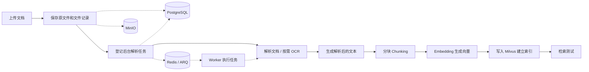

# 个人知识库与智能体项目学习笔记

## 【1】文档解析与知识入库

> 支持上传文档并配置解析、OCR 和分块策略；通过 Embedding 模型将文档块转换为向量，写入 Milvus 建立索引。使用 MinIO 保存原始文件、PostgreSQL 保存文件元数据和处理状态，通过 Redis / ARQ 与后台 worker 执行解析和索引任务。

我们就围绕**一份文档从上传到可检索**的过程展开，先把整个链路跑通，再逐段理解原理、对应代码和面试问题。

我建议以同一份测试文档贯穿三层：页面上观察它，日志里追踪它，源码中解释它。这样学到的不是彼此孤立的八股，而是“这个知识点在项目里具体解决了什么问题”。

先建立一张总地图：



这条链路有两个核心设计：文件处理与 HTTP 请求解耦；PostgreSQL 管业务事实，MinIO、Milvus 分别承担文件和检索存储。后面从数据、并发和故障恢复三个角度展开。

### 【1.1】第一层：能讲清楚流程——先亲手跑一遍

这一层的目标是回答：**一份文档进来后，经过了什么，最终在哪里能看到结果？**

我们不急着看一大堆源码，而是先在页面中完成一次可观察的实验。

#### 【1.1.1】准备测试文档和模型

准备一份不含敏感内容的 PDF 或 Markdown，里面放一个独特的事实，例如：

> 项目代号为“北极星咖啡”，上线日期为 2026 年 3 月 18 日。

这能让我们后面判断：检索结果到底来自文档，还是模型凭常识作答。

本次使用《置身钉内》PDF，Embedding 模型为百炼 `text-embedding-v4`，向量维度 1024，Batch Size 为 10。查询和入库使用同一模型配置，保证向量空间一致。

#### 【1.1.2】分开观察“解析”和“入库”

这次建议先**不勾选自动入库**，让两个阶段分别可见：

1. 创建 `Milvus` 类型知识库，记录所选嵌入模型和分块策略。
2. 上传文档，提交解析任务。
3. 观察文件状态变化，查看解析后的 Markdown。
4. 手动提交入库，观察文件状态变为 `indexed`。
5. 打开检索测试，搜索文档里的独特信息，查看返回片段和文件来源。

当前项目文档中列出的关键状态是：

| 状态                               | 含义                     |
| ---------------------------------- | ------------------------ |
| `uploaded`                         | 原文件已上传             |
| `parsed`                           | 解析后的 Markdown 已生成 |
| `indexed`                          | 分块和索引已完成         |
| `error_parsing` / `error_indexing` | 对应阶段失败或被取消     |

特别注意：**解析成功不等于已经完成向量入库**。项目也支持自动入库，但拆开操作更适合第一次学习。具体页面流程可以参考 [创建并使用知识库](D:/Projects/Yuxi-Know/docs/intro/knowledge-base.md)。

#### 【1.1.3】第一层完成标准

跑完后，你能不看资料回答：

- 上传后为什么不会立刻拿到最终检索结果？
- `uploaded`、`parsed`、`indexed` 各表示什么？
- 原始文件、解析文本、向量和文件状态分别由哪些组件承载？
- 如何证明检索确实命中了刚才上传的文档？
- 如果停在 `error_parsing` 或 `error_indexing`，分别先检查什么？

**参考回答：**

1. 上传只是保存原件；要支持检索还要经过解析、分块、向量化和索引，这些耗时操作交给后台 worker，页面通过文件状态和任务进度观察。
2. `uploaded` 表示原件已上传，`parsed` 表示解析产物已生成，`indexed` 表示分块和索引已完成。`parsed` 时显示 0 chunks 是正常的，因为还没有入库。
3. MinIO 保存原文件和解析产物；PostgreSQL 保存文件元数据、状态、后台作业和 chunk 等记录；Milvus 保存向量和检索字段；Redis / ARQ 用于任务投递和 worker 执行。
4. 在原文中选一个独特事实或术语，检索后核对片段内容、文件名和 Markdown 行号，再打开上下文确认；不能只凭相似度分数证明结果正确。
5. `error_parsing` 优先查 worker、OCR 引擎、原文件及 MinIO；`error_indexing` 优先查 Embedding 凭据、额度、批次、维度和 Milvus。先看任务详情中的具体错误，再结合日志定位。

你可以先用这样一段话讲流程，再随着学习逐渐补充细节：

> 用户上传文件后，系统保存原文件并登记文件信息；解析任务由后台 worker 执行，将文档转换为可处理的文本。之后系统按照配置分块，调用 Embedding 模型生成向量，写入 Milvus 建立索引；任务完成后，文件进入 `indexed` 状态，可以通过检索测试查看片段和来源。

------

### 【1.2】第二层：能解释原理——按数据流学八股

这一层的目标是回答：**每一步为什么需要，换一种方式会发生什么？**

不需要先把所有原理背完。每学一个概念，就回到刚才的文档实验里找对应现象。

#### 【1.2.1】文档解析与 OCR

重点理解：

- PDF、Word、Markdown 为什么不能简单地都当作纯文本读取？
- 普通文本解析与 OCR 有什么区别？
- 什么情况下需要 OCR？为什么扫描版 PDF 和可复制文字的 PDF 处理方式可能不同？
- 表格、图片、多栏排版为什么容易造成解析错误？
- **解析质量为什么会影响后续 RAG 效果？** 如果解析时把表格内容弄乱，后面的分块和向量检索很难补救。

**参考回答：**PDF 可能同时包含文字层、图片和复杂版面，Word 有段落、表格等结构，Markdown 则是带标记的文本；不能用同一种纯文本读取方式可靠还原所有内容。文本层提取直接读取已有字符，OCR 先从图像中检测文字区域，再识别字符；扫描件或图片中的文字通常需要 OCR。多栏阅读顺序、合并单元格和图表中的文字—图形关系都可能丢失。解析结果是 RAG 下游输入，漏字、错序和表格错位会传递到分块、向量和回答。

**项目实现：**本次 RapidOCR 使用 ONNX Runtime 在本地运行文字检测、方向分类和识别模型；`process_pdf` 将 PDF 逐页渲染成图片，识别文字并拼接，写成 Markdown。它能识别图中文字，但不等于理解图表趋势或可靠还原表格结构。见 [rapid_ocr.py](D:/Projects/Yuxi-Know/backend/yuxi/infrastructure/document_parsing/engines/rapid_ocr.py)。

**实践对照：**用同一份内容准备文本版 PDF 和截图或扫描版 PDF，分别解析，比较解析后的 Markdown。先看解析结果是否正确，再讨论检索效果。

#### 【1.2.2】分块 Chunking

重点理解：

- 为什么不把整篇长文档直接作为一个向量？
- 块太大：可能带入无关内容、降低定位精度；块太小：可能丢失上下文。
- 为什么相邻块可能需要重叠？重叠过大会有什么代价？
- 固定长度分块、按结构分块、语义分块有什么取舍？
- 一个 chunk 如何保留文件 ID、行号等来源信息？

**参考回答：**一篇文档混合多个主题，整体向量难以精确定位；分块可以独立召回局部事实，也避免超出模型输入限制。过小会丢上下文，过大可能混入无关信息；适当重叠可以保住跨边界语义，但会增加重复块和成本。固定长度便于控制成本，结构分块利用标题和段落保持完整性，语义分块依据语义变化切分但增加计算成本。项目在 [dispatcher.py](D:/Projects/Yuxi-Know/backend/yuxi/modules/knowledge/chunking/dispatcher.py) 中根据预设分块，并装配 `file_id`、`chunk_index`、行号和字符范围；行号对应解析后的 Markdown。此次 `book` 预设得到 3620 个块，页码也可能成为独立块，说明分块质量需要结合内容检查。

**实践对照：**对同一文档使用两组不同的分块参数，比较：

- 块的数量和长度；
- 一个完整事实有没有被切断；
- 检索结果是否容易读懂；
- 返回片段能否定位回原文。

项目的分块调度入口在 [dispatcher.py](D:/Projects/Yuxi-Know/backend/yuxi/modules/knowledge/chunking/dispatcher.py)，但第一遍先观察结果，不必立刻读懂所有策略。

#### 【1.2.3】Embedding 与 Milvus

重点理解：

- Embedding 模型把文本转换成什么？“向量相近”通常表达什么含义？
- 为什么文档入库时要做 Embedding，查询时通常也要做 Embedding？
- 什么是向量维度？为什么建索引时要确定维度？
- 为什么更换 Embedding 模型后，旧索引通常需要重新构建？
- Milvus 在这里保存和检索什么？它与模型服务有什么区别？

**参考回答：**Embedding 把文本映射到固定维度的数值向量，相近通常意味着模型认为语义相关，但不等于事实正确。入库时将文档块编码，查询时将问题编码，才能在同一向量空间比较。本次使用百炼 `text-embedding-v4`、1024 维；Milvus 的向量字段需要固定维度。换模型后即使维度相同，向量语义空间也可能不同，通常要重建索引。模型服务负责生成向量，Milvus 负责保存向量和检索字段、建立索引并执行相似搜索。

**项目实例：**本次知识库使用 `text-embedding-v4`、1024 维；文档入库时对 chunk 编码，检索时对问题编码。Milvus 向量索引采用 IVF_FLAT，距离度量为 COSINE。

#### 【1.2.4】存储分工

这部分非常适合面试，因为可以结合项目讲“为什么不是一个数据库存所有东西”。

| 组件        | 这条链路中的主要职责                       | 值得追问的问题                                   |
| ----------- | ------------------------------------------ | ------------------------------------------------ |
| MinIO       | 保存原始文件等对象                         | 为什么文件适合放对象存储？数据库里如何关联文件？ |
| PostgreSQL  | 保存文件元数据、状态以及后台作业等持久信息 | 为什么需要文件状态？任务失败如何定位？           |
| Redis / ARQ | 支持后台任务投递和执行                     | 为什么解析、索引不直接在 HTTP 请求中同步完成？   |
| Milvus      | 保存检索所需的向量及相关字段               | 向量索引与普通数据库索引有什么不同？             |

**回答与工程考虑：**MinIO 按 bucket / object key 保存原件和解析产物；PostgreSQL 用文件 ID、对象地址和状态把业务记录关联起来，并保存后台任务和 chunk；Redis / ARQ 负责投递和消费任务；Milvus 针对语义相近搜索组织向量索引。普通 B-tree 索引擅长精确、范围和排序查询；向量索引解决高维相似搜索，常以近似结果换取速度。这种分工让每个组件处理擅长的工作，同时增加跨存储一致性和故障处理的复杂度。

**PostgreSQL 写成功、Milvus 写失败怎么办？** 当前版本先写 PostgreSQL，再有限次数重试 Milvus upsert；失败后记录索引错误。查询通过文件的 `active_generation` 限定可见代次，避免将未完成的新代次当作正式结果。这里采用业务状态、版本切换和可重试写入处理跨库一致性，具体见【1.6.6】。

#### 【1.2.5】第二层完成标准

对每个组件，至少能回答三个问题：

1. **它是什么？**
2. **项目为什么需要它？**
3. **如果它出问题，用户会看到什么，怎么排查？**

**回答：**MinIO 负责对象存取，故障可能表现为上传或读取解析产物失败；PostgreSQL 保存业务状态和作业，故障可能影响任务登记或状态查询；Redis / ARQ 负责投递与执行通道，故障可能使任务停留 pending；worker 负责处理任务，停机时进度不再推进；Milvus 负责索引与检索，故障可能导致入库或搜索失败。依次查看文件状态、后台作业详情、`docker compose ps` 和 worker 日志，再定位对应组件；具体状态还取决于发生故障的阶段。

比如对 Redis / ARQ，不只背“消息队列削峰”，而是要能联系项目说：文档解析可能耗时较长，因此请求提交任务后由后台 worker 处理；用户通过文件状态或后台作业查看结果。

------

### 【1.3】第三层：能结合项目——追踪一条真实请求

这一层的目标是回答：**在这个项目里，具体是哪段代码做的？如果失败，我从哪里查？**

我们不需要一口气读完整个仓库。建议按下面的顺序，每次只追一个问题：

#### 【1.3.1】从页面操作找到后端入口

在浏览器开发者工具的 Network 面板里，观察一次上传、解析和入库操作：

- 页面分别发了哪些请求？
- 请求返回的是最终结果，还是任务信息？
- 页面如何获取文件状态？

**代码中的回答：**路由前缀为 `/api/knowledge`，上传入口包括 `POST /files/upload`，导入到知识库使用 `POST /knowledge-bases/{kb_id}/documents/add`；手动解析和入库分别是 `POST .../documents/parse` 与 `POST .../documents/index`；文件列表是 `GET .../documents`。解析、入库提交的是后台作业，最终结果要通过文件和作业状态查询，不能把提交成功等同于处理完成。路由见 [management.py](D:/Projects/Yuxi-Know/backend/yuxi/api/routers/knowledge/management.py)。页面具体请求顺序仍以 Network 为准：上传导入与手动解析是不同入口。

然后根据请求路径找到后端路由，追到 service。记录“页面操作 → API 路由 → service”，先不深入实现。

#### 【1.3.2】追踪后台任务

以**一次解析任务**为例，弄清楚：

- 后端在哪里登记任务？任务信息保存在哪里？
- Redis / ARQ 在任务投递和执行中分别承担什么作用？
- worker 从哪里进入任务处理代码？
- 成功或失败后，文件状态在哪里更新？
- 日志中的哪个标识可以帮助我们关联这次任务？

**代码中的回答：**手动动作由 `submit_knowledge_job` 在 PostgreSQL 事务中登记作业，提交后通过 ARQ 投递 `job_id`；worker 执行 `process_background_job`，根据 registry 分派到 `run_knowledge_parse`、`run_knowledge_index` 等处理器，再进入 Manager 和知识库执行器。`background_jobs` 记录任务状态、进度和错误，文件记录保存处理状态及任务关联。排查时用 `job_id` 串联任务记录和 worker 日志，用 `file_id` 关联文件、MinIO 产物与 chunk。入口见 [document_actions.py](D:/Projects/Yuxi-Know/backend/yuxi/modules/knowledge/services/document_actions.py)、[dispatch.py](D:/Projects/Yuxi-Know/backend/yuxi/modules/background_jobs/dispatch.py) 和 [background_jobs.py](D:/Projects/Yuxi-Know/backend/yuxi/modules/knowledge/services/background_jobs.py)。

项目文档描述的是：解析和索引会登记后台作业，worker 根据任务类型调用对应流程。追踪时我们会区分 **PostgreSQL 中持久化的作业记录**和 **Redis / ARQ 的执行通道**，避免把“任务都存在 Redis 里”当成结论。

#### 【1.3.3】追踪解析、分块与索引

沿着同一份文件继续看：

- **解析**：从原文件读取到生成 Markdown，中间是否使用 OCR？
- **分块**：传入的是什么文本？分块参数从哪里来？
- **Embedding**：模型 ID 和向量维度从哪里获取？什么时候发起模型调用？
- **索引**：哪些内容写入 PostgreSQL，哪些内容写入 Milvus？
- **状态**：在哪一步文件变成 `indexed`？异常时如何记录？

**代码中的回答：**本次解析由 RapidOCR 逐页识别后生成 Markdown；分块读取该文本并合并知识库、文件、本次请求的配置；Embedding 模型与维度从知识库和模型配置装配，在分块之后按 Batch Size 请求。chunk 文本、来源和代次写 PostgreSQL，向量及检索字段写 Milvus。索引处理成功后文件进入 `indexed`，索引阶段异常会走错误状态和任务错误记录。入口见 [milvus.py](D:/Projects/Yuxi-Know/backend/yuxi/modules/knowledge/implementations/milvus.py) 与 [dispatcher.py](D:/Projects/Yuxi-Know/backend/yuxi/modules/knowledge/chunking/dispatcher.py)。PostgreSQL 与 Milvus 并非同一事务，失败路径需要结合代次和清理逻辑理解。

一个可用的源码起点是 [knowledge/base.py](D:/Projects/Yuxi-Know/backend/yuxi/modules/knowledge/base.py)，其中包含文件解析和索引相关流程；随后再追到具体的 Milvus 实现和存储代码。源码阅读时以实际调用关系为准，而不是只根据文件名猜职责。

#### 【1.3.4】做一次可控排障

等正常链路跑通后，选一个低风险实验，例如在**新建的测试知识库**里配置一个不可用的 Embedding 模型，然后观察：

- 是解析阶段失败，还是索引阶段失败？
- 页面状态如何变化？
- worker 日志里能看到什么？
- 恢复模型配置后，如何重新提交入库？

**排障思路：**故障发生在 OCR / 转 Markdown 时属于解析阶段；分块、Embedding、写入索引时属于入库阶段。页面可能显示 `error_parsing` 或 `error_indexing`，具体错误与任务状态以详情和 worker 日志为准。先修复模型凭据、额度、批次或维度等原因，再按页面支持的操作重试；若要更换已绑定的 Embedding 模型，应按照项目知识库重建和索引流程处理，不把不同模型的向量混用。

这比单纯背“任务失败要重试”更有用：面试时你可以讲一次真实故障的现象、定位过程和解决办法。实验前会先确认项目允许怎样修改测试配置，避免影响已有知识库。

#### 【1.3.5】第三层完成标准

你能拿着一份实际上传过的文件，讲清楚：

> 我在页面提交了什么请求；后端在哪里登记任务；worker 执行到哪几个关键函数；文件状态怎样变化；最终哪些数据写到哪些组件；失败时我会先查哪里。

不要求你记住所有函数名，但至少能找到入口，并解释每层职责。

------

### 【1.4】建议的实际学习顺序

我们可以把这条路径分成五次小练习，每次都产出一段你能用于面试的表达：

| 次序 | 主题               | 完成后的成果                   |
| ---- | ------------------ | ------------------------------ |
| 1    | 跑通一份文档       | 状态变化记录、一张完整链路图   |
| 2    | 解析与 OCR         | 能比较两类 PDF 的解析结果      |
| 3    | 分块与 Embedding   | 能解释分块取舍、模型与维度     |
| 4    | 存储与后台任务     | 能说明四个组件的分工和排障路径 |
| 5    | 源码追踪与面试演练 | 能结合实际请求讲清关键调用链   |

### 【1.5】补充知识点

#### 【1.5.1】Milvus 的 IVF_FLAT 索引方式

全称：**IVF_FLAT = Inverted File Flat** 拆开理解，正好对应你说的「分组索引」：

1. **IVF = Inverted File，倒排文件（分组这一层）** 用 k-means 把全部向量聚类，分成 `nlist` 个组（簇/倒排列表）；每个簇有一个中心点，同一个簇里的向量放在同一个倒排链表里面。 搜索的时候先和簇中心比距离，只挑最近的 `nprobe` 个簇去搜，不用扫全部数据，这就是分组加速的逻辑。
2. **FLAT = Flat，扁平（簇内部的存储方式）** **每个簇里面，向量直接存原始完整浮点向量，不做PQ/SQ量化压缩**，簇内是暴力遍历、精确算距离，也就是FLAT暴力扫描的意思，和单独的FLAT索引是一样的计算方式，只是被包在IVF分组里面了。

- IVF_FLAT：分组（IVF）+ 簇内原始向量、无压缩
- IVF_PQ：分组（IVF）+ 簇内乘积量化压缩
- IVF_SQ：分组（IVF）+ 标量量化压缩

**IVF负责分组、缩小搜索范围；FLAT代表簇内不压缩、原样存向量，簇内暴力扫描**，所以叫 IVF_FLAT。

项目使用 Milvus 的 IVF_FLAT 建立向量索引。检索时先选择与查询向量接近的若干个聚类，再在这些聚类中比较向量相似度。它通过减少搜索范围换取速度，但可能漏掉未搜索聚类中的近邻。项目使用余弦相似度，建索引的 `nlist` 为 1024，检索的 `nprobe` 为 10。

#### 【1.5.2】Milvus的检索方式

纯向量检索，是把你的问题转换成向量，再用**余弦相似度**寻找相近的文档片段。结合我们上一轮聊的 `IVF_FLAT`，Milvus 会先选一部分候选分组，再比较其中的向量，因此它属于近似检索，不保证扫描全部 chunk。

**混合检索**则是把不同方式找到的结果结合起来。在这个项目中，具体是结合：

1. **向量检索**：从语义上找相近的片段。
2. **BM25 关键词检索**：从词语匹配上找相关的片段。
3. **结果融合**：根据两路结果和各自的权重，生成一个综合排名。

BM25 不只是数关键词出现了几次。它还会考虑词在整个文档集合中是否常见、在片段中出现的频率，以及片段长度等因素。但它主要依赖**词语匹配**，不像向量模型那样直接处理语义相近。

两者各有擅长的地方：

| 方式     | 擅长                         | 可能遇到的问题                             |
| -------- | ---------------------------- | ------------------------------------------ |
| 向量检索 | 找意思相近、但用词不同的内容 | 可能把看似相关但不能回答问题的片段排得靠前 |
| BM25     | 找专有名词、编号、明确关键词 | 用词差异较大时，可能找不到语义相关内容     |
| 混合检索 | 综合利用语义和关键词         | 最终效果仍取决于分块、权重和问题本身       |

检索配置中记录了：

```
vector_weight = 0.7
bm25_weight   = 0.3
```

当切换为**混合检索**时，这两个参数用于控制两条检索路径在最终排序中的相对影响：

- `vector_weight = 0.7`：向量检索结果的权重。
- `bm25_weight = 0.3`：BM25 关键词检索结果的权重。

项目使用 Milvus 的 `WeightedRanker` 合并两路候选结果。可以用一个**示意公式**理解：

```
融合分数 ≈ 0.7 × 向量路径处理后的分数
         + 0.3 × BM25 路径处理后的分数
```

这里强调“处理后的分数”：余弦相似度和 BM25 原始分数的范围不同，Milvus 的加权排序会先进行分数归一化，再按权重融合。因此，**不能直接拿页面上看到的原始余弦分数和 BM25 原始分数相乘、相加**；融合分数也不是正确率或概率。[Milvus Weighted Ranker 文档](https://milvus.io/docs/weighted-ranker.md)

这与 Rerank 模型有什么区别？名称容易混淆，但在你的项目里，它们是不同步骤：

```
向量检索 ─┐
          ├─→ Milvus 按权重融合 → 候选片段
BM25 检索 ┘                           ↓
                              可选：Rerank 模型精排
                                       ↓
                                  最终结果
```

- **`WeightedRanker`**：在 Milvus 里融合两路检索结果和分数。
- **Rerank 模型**，例如百炼的 `qwen3-rerank`：接收问题和候选片段，进一步判断它们是否相关，再重新排序。

你刚才那次请求的配置是 `search_mode = vector`，所以只走了向量分支；尽管配置中存在 BM25 权重，它在那次请求中**没有参与排序**。同时，当时 `use_reranker = false`，也没有调用 Rerank 模型。这些分支在项目的 [Milvus 检索实现 (line 365)](D:/Projects/Yuxi-Know/backend/yuxi/modules/knowledge/implementations/milvus.py:365) 中可以直接看到。

#### 【1.5.3】分块策略：如何把文档变成可检索的片段

**为什么要分块？**一整篇文档包含多个主题，直接用一个向量表达会让局部细节难以区分；长文也可能超出 Embedding 或生成模型的输入限制。把文档拆成 chunk 后，每个块可以单独向量化、被检索并关联来源。

分块大小需要权衡：块太小可能把一个事实和必要上下文拆开；块太大可能夹杂无关内容，影响匹配与后续上下文利用。适当重叠可以减轻边界截断，但也会增加重复内容、向量数量和模型调用量。具体效果需要针对文档与问题实测。

**项目提供哪些预设？** [presets.py](D:/Projects/Yuxi-Know/backend/yuxi/modules/knowledge/chunking/presets.py) 注册了 `general`（按分隔符和长度的通用分块）、`qa`（问题与回答）、`book`（章节标题与层级合并）、`laws`（法条层级）、`semantic`（利用嵌入和聚类做语义切分）和 `separator`（严格按分隔符切分）。`general` 是默认预设，并映射到内部 `naive` 实现；这是一组策略预设，不代表每个预设都一定适合所有文档。

**配置从哪里来？** `resolve_chunk_processing_params` 依次合并知识库、文件和本次请求的配置：后者覆盖前者的同名预设；`chunk_parser_config` 按相同顺序递归合并。实际执行时，[dispatcher.py](D:/Projects/Yuxi-Know/backend/yuxi/modules/knowledge/chunking/dispatcher.py) 将解析后的 Markdown 分派给对应分块器，并为结果装配文件 ID、chunk 索引和可定位的来源范围。界面展示的行号属于解析后的 Markdown，并非 PDF 页码。

**本次文档**：《置身钉内》使用 `book` / `ragflow_like_v1`，得到 3620 个 chunk。检索曾返回只有页码和文件名的 chunk，这是解析清洗、结构识别和分块之间相互影响的具体表现：分块器把输入文本切开，却无法自动判断每段文字的业务价值。优化时应先检查重复页眉页脚，再看标题识别和短块合并，最后调块大小。

**面试表达**：项目支持针对不同文档结构选择分块预设。我跑通了书籍预设，观察到 OCR 产生的页码也可能成为独立片段，因此会通过检索结果和原文定位检查分块质量，再比较不同策略。

#### 【1.5.4】MinIO：文件和解析产物存在哪里

MinIO 是兼容 S3 接口的对象存储。可以把 bucket 理解为对象的容器，把 object key 理解为对象在 bucket 内的标识；它适合存放 PDF 等文件和解析产物，而 PostgreSQL 适合管理文件 ID、名称、状态及对象地址等业务信息。对象存储不是向量数据库，MinIO 本身不负责对文档语义做相似搜索。

**本项目链路**：上传时，[uploads.py](D:/Projects/Yuxi-Know/backend/yuxi/modules/knowledge/services/uploads.py) 对内容计算哈希，生成带 UUID 的暂存对象路径并上传 MinIO；导入时登记文件记录。解析任务读取原始对象，将生成的 Markdown 等产物发布到对象存储；入库任务再读取解析后的 Markdown 并分块。日志中能看到本次 worker 从 `knowledgebases` bucket 下载 `document.md`，随后才执行分块。文件记录中的 `minio_url`、`markdown_file` 用于关联相应对象。

**常见追问**：对象存储和本机目录有何区别？本次 MinIO 虽由本机 Docker 部署，应用通过对象存储接口读写，而不是把数据库里的对象地址当成本机文件路径。为什么不是把 PDF 全部存在 PostgreSQL？本项目选择将文件产物与业务记录分离，各自处理存储与查询；并不意味着 PostgreSQL 技术上不能保存二进制。

**注意**：云端 OCR 可能需要把文档传给供应商；本次 RapidOCR 在本地运行。删除知识库涉及相关文件和派生数据的清理，不能只凭删除数据库行就假设所有外部对象已同步消失。

#### 【1.5.5】Redis、ARQ 与 PostgreSQL：后台任务如何交接

Redis 是内存数据服务，ARQ 是基于 Redis 的 Python 异步任务队列。两者在此处的关系是：**ARQ 使用 Redis 作为任务执行通道，worker 从中取得待执行任务**。PostgreSQL 则持久化 `background_jobs` 记录、任务状态和业务参数；不应把队列里的消息等同于完整、唯一的任务事实。

以手动提交入库为例：

```text
页面请求 → API 校验 → 在 PostgreSQL 登记后台作业并提交
                                  ↓
                      ARQ 通过 Redis 投递 job_id
                                  ↓
                       worker 领取并执行对应处理器
                                  ↓
                   更新作业进度及文件状态，供页面查询
```

[document_actions.py](D:/Projects/Yuxi-Know/backend/yuxi/modules/knowledge/services/document_actions.py) 在事务内登记作业，事务结束后触发投递；[dispatch.py](D:/Projects/Yuxi-Know/backend/yuxi/modules/background_jobs/dispatch.py) 调用 `enqueue_job("process_background_job", job_id)`。作业类型和处理器的映射在 [registry.py](D:/Projects/Yuxi-Know/backend/yuxi/modules/background_jobs/registry.py)，解析和入库处理入口在 [background_jobs.py](D:/Projects/Yuxi-Know/backend/yuxi/modules/knowledge/services/background_jobs.py)。上传导入也可能产生 `knowledge_ingest` 作业，不能把所有操作都当成同一个 API。

**为什么任务不直接在 HTTP 请求里做完？** PDF 的 OCR 和向量化耗时长，容易超过请求或代理超时；API 提交任务后即可返回，worker 独立处理，页面查询进度。项目为已登记但投递失败的 pending 任务提供补发路径，并用数据库 claim 控制重复消息；claim、lease 和幂等写入的区别见【1.6.4】。

**本次观察**：`knowledge_index` 作业从 20:00:43 到 20:03:37，耗时约 173 秒；文件状态变为 `indexed`。把这段处理放在后台，可以让页面及时得到任务标识，再持续展示进度。

#### 【1.5.6】Worker：实际执行解析和入库的后台进程

Worker 是执行后台任务的进程；Redis 是存储和通信组件，ARQ 是任务队列 / 执行框架，三者不是同一种东西。这个项目由 Docker Compose 分别运行 API 和 worker：API 负责响应请求、登记任务；worker 负责消费任务并运行对应业务处理逻辑。它们共享数据库和存储服务，但运行在不同的服务进程中。

**结合这次 PDF**：worker 调用 RapidOCR 处理 105 页，日志按页显示进度；之后的入库作业读取 Markdown、分块、调用百炼 Embedding，再写入 PostgreSQL 和 Milvus。文件状态、作业进度和日志分别回答“文件走到哪一步”“任务执行情况”“具体在哪里报错”。

**排障顺序**：先看页面中的文件状态与后台作业详情，再用 `docker compose ps` 看服务状态，用 `docker compose logs --tail 100 worker` 看相关时间段的日志；根据 job ID 和 file ID 关联任务，再检查 MinIO、模型接口、PostgreSQL 或 Milvus。日志可能含文档内容，分享前先检查。

**面试表达**：我把 PDF 解析和向量入库分成可观察的后台任务。API 持久登记任务后，通过 Redis / ARQ 通知 worker；worker 执行对应处理器，并让页面通过任务与文件状态查看进度。我的实践中区分了 `parsed` 的 0 chunks 和 `indexed` 的 3620 chunks。

#### 【1.5.7】Embedding 批次、维度与数据一致性

Embedding 模型把每个 chunk 映射为向量；查询时用同一模型将问题转换为向量，再在 Milvus 中搜索。向量维度必须与 collection 配置一致；换了模型，即使维度相同，语义空间也未必兼容，通常需要重新建立索引。

本次采用百炼 `text-embedding-v4`，实际返回 1024 维，Batch Size 配置为 10。**Batch Size 是每次向模型接口提交的 chunk 条数，不是 chunk 长度。**项目入库代码还用另一层批次组织写入：最多 200 个 chunk 一组，再由 Embedding 函数按模型批次拆分调用；两种批次不要混为一谈。

**两种数据库怎样保持一致？** [Milvus 实现](D:/Projects/Yuxi-Know/backend/yuxi/modules/knowledge/implementations/milvus.py) 的 `_insert_chunks_to_stores` 先把 chunk 事实 upsert 到 PostgreSQL，再将派生向量 upsert 到 Milvus，后者进行有限次数重试。索引完成后才发布新代次；查询侧再用 PostgreSQL 的当前代次校验 Milvus 命中，完整机制见【1.6.6】。

### 【1.6】深入机制：从处理链路聊到工程设计

#### 【1.6.1】OCR 的三个模型分别在算什么，为什么图表难处理

OCR 是任务名称，RapidOCR 是实现这类任务的工具；ONNX 是模型计算图及权重的交换格式，ONNX Runtime 是执行计算图的推理引擎。模型训练和推理是两件事：项目加载已经训练好的权重，对本次 PDF 做推理。

本次本地链路包含三个模型：

1. **文字检测 det**：在页面图像中找文字区域，输出位置。漏检的文字不会进入后续识别。
2. **方向分类 cls**：判断文字行方向，协助处理倒置文字；它与整页的版面分析不是同一任务。
3. **文字识别 rec**：把裁剪后的文字图像转换为字符序列。错别字往往在这里产生。

在 `rapid_ocr.py` 中，`process_pdf` 用 pypdfium2 逐页渲染，`scale=2`，再调用图片 OCR，最后把 `result.txts` 拼接。放大页面可以让小字更清楚，也会增加像素数：长宽各变成两倍，像素数约为四倍，推理和内存压力随之上升。

**为什么识别出表格里的字，仍然可能回答错？**表格的语义依赖行列对应关系，例如“收入 100、利润 10”必须知道各数字对应什么表头。文字识别只解决字符问题，版面分析、单元格识别和表头关联才解决结构问题。折线图还需要理解坐标轴、图例、数据点与趋势，单靠 OCR 识别标签不足以还原结论。

**怎么选择解析方案？**有可靠文本层的 PDF，可优先考虑直接提取以保留字符并降低计算；扫描件需要 OCR；复杂表格或图表可引入版面模型、表格模型或视觉语言模型。当前 RapidOCR 路径会逐页渲染，不会因为 PDF 有文字层就自动走文字提取。选择时要同时比较阅读顺序、表格结构、延迟和调用成本，而不是只比较有没有输出 Markdown。

#### 【1.6.2】分块怎样影响召回、成本和生成上下文

**分块的基本单位是“可独立检索的证据”。**一句“它在三个月后关闭”如果脱离主语和时间，虽然能被编码，却难以回答问题。因此块大小应围绕事实完整性设计，而不是只追求某个固定长度。

设长度为 `L`、块大小为 `s`、重叠为 `o`，且使用同一种长度单位、`0 ≤ o < s`，固定滑窗的块数大致为：

```text
N ≈ 1 + ceil(max(0, L - s) / (s - o))
```

长度为 10000 的文本，块大小 500：不重叠约 20 块；重叠 100 约 25 块。增加重叠会同时增加 Embedding 输入、向量存储、重排文本和回答上下文中的重复。字符数和 Token 数不是同一个单位，接口限制需要按模型 Token 预算处理。

**项目策略如何选择？**

| 文档特征 | 策略思路 | 工程关注点 |
| --- | --- | --- |
| 普通长文 | `general` 按分隔符与长度切分 | 段落完整性、长度上限、重叠 |
| 书籍 | `book` 利用章节层级 | OCR 后标题还在不在，页眉是否干扰 |
| 问答资料 | `qa` 尽量保持问答配对 | 问题与回答不能分离 |
| 法律条款 | `laws` 保留条款层级 | 条号、上位标题和引用关系 |
| 主题边界不明显 | `semantic` 利用嵌入信息切分 | 额外向量计算与可重复性 |
| 已有可靠边界 | `separator` 按指定分隔符 | 分隔符是否稳定、异常超长块 |

项目由 `dispatcher.py` 统一产出 chunk 记录，再用 `SourceSpanLocator` 装配来源范围。分块策略和定位职责分开，新增策略可以复用后续存储与来源展示。

**为什么不直接把块越切越大？**检索的目标是选出高密度证据。大块包含多个主题时，一个向量要概括更多信息；即使命中，也会消耗更多生成上下文。对于“标题命中了但解释在后面”的情况，可以采用较小片段召回，再读取相邻原文；本项目的 `open_kb_document` / `find_kb_document` 提供了这种补充上下文的能力。父子块检索也是类似思路，但需要额外维护父子映射。

**怎样评价分块？**看完整事实是否被截断、页眉页脚是否污染、相同事实是否大量重复，以及目标证据的 Recall@K。单看 chunk 数量没有方向性，3620 块既可能提高定位粒度，也可能包含大量短噪声。

#### 【1.6.3】MinIO 为什么适合文件，API 和 worker 怎么共享产物

对象存储采用 `bucket + key → 对象内容及元数据` 的访问方式。key 中可以出现 `/`，但这种“目录”主要是命名前缀，应用不能按本机文件系统的路径和重命名语义理解它。

**为什么文件不直接塞业务表？**将几十 MB 的原件与经常更新、查询的文件状态分开，可以减少大对象对数据库备份、复制和查询负载的影响。PostgreSQL 管理结构化关联和事务，MinIO 负责对象上传、下载与容量扩展。关系库也能存二进制，取舍在于负载与管理成本。

**为什么不让 API 把临时文件路径传给 worker？**API 与 worker 是不同容器，API 的 `/tmp/a.pdf` 不必存在于 worker。使用对象地址后，worker 可以独立下载原件、生成 Markdown，再发布解析产物；业务流程不依赖两个进程共享同一临时目录。

上传服务计算内容哈希，并采用带 UUID 的暂存对象路径：哈希可用于识别相同内容，UUID 路径用于区分上传对象。两者用途不同，计算了哈希并不等于已经实现全局去重。

**对象上传成功，文件记录写入失败怎么办？**这会产生无业务引用的对象；反过来则可能产生指向不存在对象的记录。这类问题通常通过明确发布顺序、失败清理和按引用关系清理孤立对象来处理。数据库事务不能回滚一次已经成功的 S3 上传。排查时同时核对文件记录中的 key 和对象实际存在性。

#### 【1.6.4】Redis / ARQ 怎样避免任务丢失和重复执行

这里要分清三个问题：**持久登记任务、通知执行、取得执行权**。

```text
PostgreSQL 登记 pending 并提交
        ↓
Redis / ARQ 投递 job_id
        ↓
worker 对 PG 作业执行 claim
        ↓
领取成功 → running → 心跳续租 → 提交终态
```

**为什么先提交数据库再投递？**先投递可能导致 worker 读不到尚未提交的任务。先提交则留下“提交成功、通知失败”的窗口；项目的补发机制重新发现 pending 作业并投递。这与事务发件箱要解决的是同类跨系统通知问题，当前实现以持久作业记录为恢复入口。

**补发为什么不会让两个 worker 正常领取同一 pending 作业？**`BackgroundJobRepository.claim` 在事务内锁定作业行，只允许 `pending` 转为 `running`，同时写入 `worker_id`、attempt、心跳与租约。重复队列消息到达时，后续领取者看到状态已经改变，就不能再领取。并发上限启用时，代码还用事务级 advisory lock 串行化“检查容量并领取”这一步。

**worker 崩溃了怎么办？**只记录 `running` 会让任务永久卡住，因此项目记录 `lease_expires_at`，worker 持续心跳续租。更新进度、结果时会核对当前 owner 和有效 lease，并使用 PostgreSQL 时钟减少多进程时钟差异。租约过期后，作业会得到失败结局，错误中指出副作用结果未知；不能把超时直接理解成外部操作没有发生。

**claim 等不等于 exactly-once？**它控制数据库中的执行归属，但一次外部写入可能已经成功、响应却在网络中丢失。要处理这种重复，需要业务幂等：例如相同 chunk ID 的 upsert、同一代次的写入、相同实体的稳定标识。领取、消息去重和副作用幂等分别解决不同问题。

**为什么不只加 Redis 锁？**PG 已经拥有任务状态，把锁定、状态转换和 owner 写入放在同一个数据库事务里更直接。额外 Redis 锁会增加另一份需要协调的状态。PG 租约仍然不能自动阻止一个已经发出的外部请求，因此外部写入也要考虑重复和过期执行者。

源码：[任务投递](D:/Projects/Yuxi-Know/backend/yuxi/modules/background_jobs/dispatch.py)、[领取与租约](D:/Projects/Yuxi-Know/backend/yuxi/modules/background_jobs/repository.py)。

#### 【1.6.5】Worker、async、线程池、批次与并发分别控制什么

worker 是进程角色，`async` 是协作式调度方式，线程池是执行同步函数的机制。一个 async worker 可以在等待网络时处理别的任务，但一个同步 OCR 或数据库 SDK 调用如果直接占住事件循环，其他协程连心跳都可能无法及时执行。

项目创建 / 加载 Milvus collection 时使用 `asyncio.to_thread`；查询使用 `BoundedOffload` 将同步存储 I/O 放到线程，并分别以 8 个容量限制 Milvus、Neo4j 查询。**为什么既卸载又限流？**卸载避免事件循环阻塞，限流避免大量并发请求把线程、数据库连接和内存耗尽。限制按事件循环生效，增加 worker 进程也会增加总并发预算。

这里有一个细节：取消等待中的协程，底层线程未必停止。`BoundedOffload` 用 `asyncio.shield`，直到线程实际结束才归还容量；否则用户反复取消请求就可能绕过并发上限，让后台仍在执行的线程越积越多。见 [offload.py](D:/Projects/Yuxi-Know/backend/yuxi/modules/knowledge/storage/offload.py)。

**Batch Size 和并发数不同。**本次 Embedding batch=10 表示一次请求包含 10 个 chunk；并发=4 则表示最多同时进行 4 个请求，两者同时设置时最多会有约 40 个 chunk 在模型侧处理中。实际吞吐还受每分钟请求数 RPM、Token 数 TPM、网络与模型延迟限制。

3620 个块、每批 10 个，不计重试约需 362 次向量请求。增大 batch 可以摊薄请求固定开销，却会受接口条数与 Token 上限限制，并增加单次失败重做量。外层 200 个 chunk 的入库批次管理内存和写入节奏，不会把供应商的 batch 上限也变成 200。

CPU 密集任务还要区分 Python 计算与释放 GIL 的本地库：纯 Python 计算通常不能仅靠多线程提高多核吞吐，ONNX 等本地推理库则有自己的线程机制。优化要先测 CPU、网络等待和模型耗时，再决定进程数、线程数或请求并发。

#### 【1.6.6】generation 如何隔离半成品索引，为什么跨库事务不是答案

PostgreSQL 保存 chunk 事实，Milvus 是检索投影。若直接覆盖当前索引，写到一半失败，用户可能搜到新旧混杂的片段。项目使用**构建代次与当前生效代次**区分“正在生成的数据”和“正式可见的数据”。

源码流程：

1. `begin_index_generation` 分配本轮代次。
2. chunk 记录附加 `generation`，chunk ID 也追加 `-g{generation}`，避免不同代次互相覆盖。
3. 分批计算向量；`_insert_chunks_to_stores` 先 upsert PG，再 upsert Milvus，Milvus 写入有限重试。
4. 全部处理完成后，`finish_index_generation` 发布当前代次和文件统计。
5. 查询用 `_build_active_generation_expr` 过滤文件的当前代次；`_hydrate_chunk_sources` 再核对 PG 中的来源、文件及当前代次。

例如旧代次为 g1，新构建 g2 只写了一半：g2 即使已存在 Milvus，也不应作为当前代次返回。具体能否继续搜索旧结果，还取决于文件当前状态与有效性条件；核心是避免把未发布的 g2 混入正式结果。

**为什么还要从 PG 补来源？**Milvus 中可能残留旧代次或孤立数据；PG 回读既能取得文件名、行号，也能淘汰与当前业务事实不匹配的命中。代价是多一次数据库访问，而且过滤后返回数可能少于最初候选数。文档量大时，按文件拼接代次过滤表达式本身也会增加查询成本。

**删除顺序也有考虑。**`delete_file_chunks_only` 先删除图谱贡献和 Milvus 数据，外部删除成功后才移除 PG chunk 记录。这样外部系统失败时，仍保留可定位、可重试的元数据。

这套设计采用代次隔离、状态发布与清理，处理派生索引的一致性。它适合“业务数据有明确来源，索引可重建”的场景；如果强行把全部外部调用包进一个长数据库事务，既不能让 Milvus 自动参与 PG 原子提交，还会延长锁与连接占用。

#### 【1.6.7】PostgreSQL 的事务、MVCC、行锁与索引怎样联系任务系统

关系数据库不只是存一张“文件信息表”。在本项目中，它还承担任务登记、状态转换、执行归属和当前索引版本等需要一致判断的数据。

**事务的原子性用在哪里？**登记任务与对应的领域变更可以在同一事务提交；发布新索引代次、更新文件终态和登记旧代次清理意图也在同一事务完成。这样不会出现“已告诉用户 indexed，但当前代次仍没切换”的中间提交。PG 事务的原子范围止于参与该事务的数据库操作，不能覆盖 MinIO 上传或 Milvus 写入。

**MVCC 与行锁分别解决什么？**MVCC 让查询按可见版本读取，减少普通读写之间的直接阻塞；但它不能自动避免两个 worker 都先读到 pending、再各自执行。领取任务还要通过行锁和事务内状态判断实现竞争控制。锁等待期间数据库连接与事务仍被占用，因此不能拿着任务行锁做几分钟 OCR。

项目的做法是：在短事务中取得执行权并提交，耗时工作在事务外执行，通过 owner、心跳和 lease 管理后续归属。文件索引的锁定逻辑按 Job → File 的固定顺序取得锁，并在等待文件锁后重新检查租约。固定锁顺序有助于减少死锁，重新校验避免等待期间执行资格已失效。

**B-tree 索引和向量索引有什么不同？**按 `file_id` 查记录、按状态和时间扫描待处理作业，适合考虑普通索引；按语义距离找近邻，则由 Milvus 的向量索引完成。普通索引也不是越多越好：它会增加写入、更新和维护成本。复合索引应围绕真实 WHERE、排序和选择性设计，再用执行计划确认，不能只按字段个数堆索引。

**连接池为什么要有限？**每个连接都消耗服务端资源，API、worker、checkpoint 等用途还会叠加。连接不释放或长事务可能表现为大量请求等待，而不是单条 SQL 很慢。项目 SQLAlchemy engine 支持 `pool_size` 与 `max_overflow` 配置；调优时要区分“等连接”“执行 SQL”和“等外部模型”。

源码：[文件代次与锁顺序](D:/Projects/Yuxi-Know/backend/yuxi/modules/knowledge/repositories/files.py)、[PG 连接管理](D:/Projects/Yuxi-Know/backend/yuxi/infrastructure/postgres/manager.py)。

#### 【1.6.8】Redis 为什么快，AOF 为什么仍不能替代业务状态

Redis 主要在内存中组织数据，命令执行路径通常较短，适合队列协调、短期事件、取消信号和缓存。网络延迟、大对象、慢命令、持久化及内存压力仍会影响它；“内存服务”不等于所有操作都没有延迟。

项目让 ARQ 管理队列协议，不应将它简单等同为自己执行 `LPUSH/BRPOP` 的列表队列。应用层主要发送 handler 名与 job ID，由框架组织调度；任务参数、最终状态和执行 owner 由 PG 保存。

Compose 对 Redis 启用了 `--appendonly yes`，AOF 记录写命令以支持恢复；RDB 则是快照思路。恢复点与丢失窗口还取决于持久化刷盘配置及故障方式。即便启用 AOF，也解决不了“PG 提交成功、Redis 通知尚未发出”这种跨系统窗口，因此仍需要 PG pending 补发。

TTL 适合短期事件与临时数据的生命周期管理，但任务最终结果不能只靠一个会过期的缓存 key。Redis 在这个项目里的价值是低延迟协调，PG 的价值是可查询、可事务更新的持久业务事实，二者分工明确。

#### 【1.6.9】这一章怎样形成连续追问

**面试官：为什么要用队列？**解析与向量化耗时长，API 快速登记任务，worker 独立执行，还能单独调整并发。

**追问：Redis 故障，任务会丢吗？**任务事实先落 PG，Redis 负责通知，pending 作业有补发入口。重点是持久事实与投递通道分开。

**追问：补发会不会重复？**重复消息通过 PG 原子 claim 控制正常领取；外部副作用则靠稳定 ID、upsert 和代次等业务幂等处理。

**追问：写入 PG 成功，Milvus 失败怎么办？**有限重试，记录失败；新代次全部完成才发布，查询只接受当前代次，并回 PG 校验来源。恢复时围绕 file ID、generation 和 job ID 追踪。

**追问：为什么不把并发开大？**吞吐受 CPU、模型 RPM/TPM、连接池和外部存储约束。先测各阶段耗时，再分别调整模型 batch、任务并发和同步 I/O 线程容量。

### 【1.7】《置身钉内》：一次完整的解析与入库复盘

#### 【1.7.1】实验记录与一分钟讲述

2026 年 11 月 5 日，基于 Yuxi-Know 本地部署版本 `220ae2b`，使用《置身钉内》PDF 走通上传、解析、入库、检索和智能体问答。实验记录如下：

| 阶段 | 配置与观察 | 对应理解 |
| --- | --- | --- |
| 原文件 | PDF 105 页、约 33 MiB；抽样页面有文本层 | PDF 同时可能包含文字、图片及复杂版面 |
| 解析 | RapidOCR 将页面渲染为图像，本地 ONNX 模型识别后生成 Markdown | 文字层提取和 OCR 是不同路径；该 OCR 路径逐页渲染 |
| 解析完成 | 文件为 `parsed`，显示 0 chunks | 解析生成文本，分块与入库尚未执行 |
| 分块 | `book` / `ragflow_like_v1`，共 3620 个 chunk | 结合章节结构切分；块数需要配合质量检查 |
| 向量化 | 百炼 `text-embedding-v4`，1024 维，模型 batch size 为 10 | 一次模型请求最多按配置处理 10 个 chunk |
| 入库 | 20:00:43 至 20:03:37，约 2 分 53 秒，文件为 `indexed` | PG 有 3620 条 chunk 记录，worker 日志显示向量写入 Milvus 成功 |
| 检索 | 一次纯向量检索返回 10 条；使用余弦相似度，未开启 Rerank | 命中结果附文件和 Markdown 原文位置 |

项目记录的 `token_count` 为 82751，是项目统计，不等于供应商账单。3620 块、每批 10 条，理论上约需 362 次基础 Embedding 请求；重试会影响实际次数。模型外层的入库批次和单次模型请求批次是两层概念。

**一分钟表达：**我基于 Yuxi-Know 部署知识库平台，用一份 105 页图文 PDF 跑通入库和检索。原件与 Markdown 保存在 MinIO，PostgreSQL 管理文件状态、作业和 chunk，Redis / ARQ 将任务投递给 worker。本次用本地 RapidOCR 逐页识别，book 预设得到 3620 个块，再调用百炼 Embedding 生成 1024 维向量，写入 Milvus。检索结果保留文件及 Markdown 行号，可以打开上下文核对来源。

#### 【1.7.2】实验现象怎样转化为工程思考

**解析完成却是 0 chunks。** `parsed` 表示文本产物已经生成；本次将解析和入库拆开，只有入库时才切块、计算向量和写索引。排查时要先区分阶段，而不是把 0 chunks 直接当作 OCR 没有识别到文字。

**检索第一名是页码和文件名。** 这次某个宽泛问题的第一条结果只有 `26 / 105` 和文件名。说明 OCR 输出的页眉页脚也可能被切成独立块，文件名等内容也可能影响语义匹配。改进顺序是先检查解析产物和噪声清洗，再比较标题识别、短块合并和分块参数，最后用具体问题评价召回。

**行号与块索引。** `#1` 是本次结果排名；`chunk_index=799` 是文件内从 0 开始的块序号；`行 1009–1011` 是解析后 Markdown 的来源范围，不是 PDF 页码。点击来源后右侧显示的是 Markdown 上下文，范围通常大于本次召回的 chunk。

**Agent 读取上下文。** 提问“望舒行动”时，检索先找到标题，Agent 三次尝试打开原文时将行号或偏移量写成字符串而未通过类型校验，随后用 `find_kb_document` 找到上下文。整轮约 178 秒，最后一次模型调用约 113 秒；拆分模型和工具耗时，能判断优化应先看模型等待、工具参数还是检索。后续同一对话问“望书”时没有调用工具，可能复用了已有上下文；对照同音字检索应使用检索测试或新会话。

**模型配置排障。** 模型列表接口可访问，不代表推理请求的凭据、权限或额度均正常；索引阶段还需要检查模型维度和 batch size。定位时先按 `error_parsing` / `error_indexing` 划分阶段，再用 job ID、file ID 串联 worker 日志、对象和数据记录。

#### 【1.7.3】源码追踪路线与练习

```text
前端请求 → knowledge/management.py → document_actions.py 登记任务
         → background_jobs/dispatch.py 投递 job_id
         → registry.py / knowledge/services/background_jobs.py 分派 worker
         → knowledge/base.py / rapid_ocr.py 解析
         → chunking/dispatcher.py 分块并装配来源
         → models/embed.py 分批向量化
         → implementations/milvus.py 写入 PG 与 Milvus
         → storage/milvus.py 中的向量与 BM25 索引
```

入口：[知识库路由](D:/Projects/Yuxi-Know/backend/yuxi/api/routers/knowledge/management.py)、[任务登记](D:/Projects/Yuxi-Know/backend/yuxi/modules/knowledge/services/document_actions.py)、[任务投递](D:/Projects/Yuxi-Know/backend/yuxi/modules/background_jobs/dispatch.py)、[任务注册](D:/Projects/Yuxi-Know/backend/yuxi/modules/background_jobs/registry.py)、[任务处理器](D:/Projects/Yuxi-Know/backend/yuxi/modules/knowledge/services/background_jobs.py)、[解析流程](D:/Projects/Yuxi-Know/backend/yuxi/modules/knowledge/base.py)、[RapidOCR](D:/Projects/Yuxi-Know/backend/yuxi/infrastructure/document_parsing/engines/rapid_ocr.py)、[分块调度](D:/Projects/Yuxi-Know/backend/yuxi/modules/knowledge/chunking/dispatcher.py)、[Embedding 批处理](D:/Projects/Yuxi-Know/backend/yuxi/modules/models/embed.py)、[Milvus 执行器](D:/Projects/Yuxi-Know/backend/yuxi/modules/knowledge/implementations/milvus.py)、[索引配置](D:/Projects/Yuxi-Know/backend/yuxi/modules/knowledge/storage/milvus.py)。上传导入还可能通过 `knowledge_ingest`，与手动解析入口不同。

后续可用同一组问题比较向量、BM25、混合检索和 Rerank，记录候选、排名、来源和耗时；对照 PDF 和 Markdown 检查表格结构；再用一个测试知识库观察解析或入库失败及恢复。复述时从一次页面操作开始，用文件 ID 和 job ID 追到 worker 及存储。

## 【2】混合检索与结果重排

> 基于 Milvus 实现向量检索、BM25 关键词检索及混合检索，结合可配置的 Rerank 模型对候选文档片段重排序；检索结果保留文件来源和原文定位信息，支持在前端查看依据。

对，这一部分的重点确实是**检索原理和项目工程实现**。不过我建议保留少量手动实验：不需要重新上传或解析文档，只用同一组问题切换检索配置，观察结果有什么变化。这样你讲 BM25、混合检索和重排时，可以结合真实结果，而不是只背定义。

我们可以按三层展开。

### 【2.1】第一层：跑通并观察检索流程

你已经完成了纯向量检索：问题经过 `text-embedding-v4` 转为向量，Milvus 返回了 10 个相似片段。接下来可以围绕同一份文档，做四组对照：

| 组别 | 检索配置          | 要观察什么                           |
| ---- | ----------------- | ------------------------------------ |
| A    | 纯向量检索        | 语义相关的片段能否被召回？           |
| B    | BM25 关键词检索   | 包含关键字的片段排在哪里？           |
| C    | 混合检索          | 两路结果融合后，排名有何变化？       |
| D    | 混合检索 + Rerank | 重排前后的结果顺序和相关性有何变化？ |

先用两个已有问题就够了：

- **原文词语**：`望舒行动是什么意思？`
- **同音字变体**：`望书行动是什么意思？`

两次都在知识库的**检索测试**里执行，避免聊天上下文影响。每组记录前几条片段、排名、来源行号和是否能回答问题。这个实验不会天然证明哪种方式更好，但能帮助我们解释实际现象。

项目的检索测试使用**知识库中已保存的检索配置**。切换模式和重排配置后，要先保存再测试；实验结束可以改回你喜欢的配置。向量检索和 Rerank 分别可能调用 Embedding、重排模型，注意查看百炼额度。

做实验前先确认 Docker 项目已经启动，再打开知识库的检索测试页面。

### 【2.2】第二层：围绕检索链路学原理

这一层不只是记定义，而是能说明每个组件解决什么问题，以及它可能失败在哪里。

#### 【2.2.1】向量检索

需要理解：

- 查询向量和文档向量为什么必须处在兼容的向量空间？
- 余弦相似度衡量什么？为什么高相似度不等于答案正确？
- `IVF_FLAT` 如何通过搜索部分聚类加速？为什么可能漏召回？
- `nlist`、`nprobe` 和召回率、延迟有什么关系？
- 什么是 Top K？候选数量过少或过多有什么影响？

**参考回答：**

- **兼容的向量空间**：文档和查询要用相互兼容的模型编码，否则即使都是 1024 维，相同坐标也可能表达不同语义，距离没有可靠意义。本项目为每个知识库绑定 Embedding 模型，入库和查询使用该配置。
- **余弦相似度**：比较两个向量方向的接近程度，值越大通常表示方向越接近；向量表示的是模型对语义的编码，分数不是正确率。问题和页码片段可能因为文件名相近而得高分，却不能回答问题。
- **IVF_FLAT**：先按向量聚类建立倒排列表，查询时选择接近查询向量的若干簇，在这些簇内比较原始向量；真正最近的向量可能位于未搜索簇中，因此是近似最近邻搜索。
- **`nlist` 和 `nprobe`**：`nlist` 是建索引时的分组数，`nprobe` 是查询时搜索的分组数。其他条件相同，增加 `nprobe` 往往扩大搜索范围、提高向量近邻召回，但也增加延迟；`nlist` 要结合数据规模和 `nprobe` 调整，没有通用最优值。项目当前为 1024 和 10。
- **Top K**：按检索分数选出的前 K 个候选或结果。K 太小可能漏掉相关片段；太大可能引入噪声、增加后续重排和生成成本。这里的 K 应区分各路召回数量与最终返回数量。

**结合项目**：当前代码使用 `COSINE`，向量索引配置 `IVF_FLAT / nlist=1024`，检索参数 `nprobe=10`。这些参数是当前实现，不代表一定是这份文档的最优值。

#### 【2.2.2】BM25 与中文关键词检索

需要理解：

- BM25 如何利用词频、词在集合中的区分度和文档长度计算相关性？
- 为什么它适合专有名词、编号等明确词项？
- 中文不像英文天然以空格分词，**中文分词器**为什么会影响匹配？
- 为什么同音错字不一定能被关键词检索识别？

**参考回答：**BM25 是词项相关性排序方法：词在片段中出现可以提高得分，但高频词的收益会逐渐饱和；在大量片段中都出现的常见词区分度较低，较少见的词通常更有区分度；算法还会对片段长度做归一化，避免长片段仅因词多而占优势。它适合匹配型号、术语、错误码等明确字面内容，但不天然理解同义词或语音相似性。

中文需要分词或文本分析，切分成哪些词项直接影响能否匹配：例如“望舒”和“望书”虽然同音，却是不同字符，BM25 不会因为发音相同就自动纠错，实际命中还取决于分词和其他共享词项。本项目为 `content` 启用中文 analyzer，并由 Milvus BM25 函数和稀疏倒排索引支持关键词检索；`bm25_top_k` 控制这一路的候选数量。比较原词与错字时，应固定其他参数并实际查看返回结果。

**结合项目**：Milvus 的正文 `content` 字段启用了中文分析器，项目通过 BM25 函数生成稀疏检索字段，并使用稀疏倒排索引。实现见 [Milvus 存储配置](D:/Projects/Yuxi-Know/backend/yuxi/modules/knowledge/storage/milvus.py)。

#### 【2.2.3】混合检索与融合

需要理解：

- 语义检索和关键词检索为什么能够互补？
- 两路原始分数为什么不能直接比较？
- 加权融合和 RRF（倒数排名融合）各是什么思路？
- 权重如何影响排名？为什么权重不是“正确率”？
- 候选集本身没召回目标片段时，融合能不能救回来？**一般不能把两路都没找到的片段凭空变出来。**

**参考回答：**向量检索擅长语义相近，BM25 擅长明确词项；两路互补，可以让用词不同的相关片段和准确命中术语的片段都有机会进入候选集。两路分数的量纲和分布不同，不能直接把原始余弦分数与 BM25 分数相加。项目用 Milvus `WeightedRanker` 对分数处理后按权重融合；权重表示排序时对路径的相对重视，不是该路径正确的概率。

**加权融合与 RRF：**加权融合使用各路处理后的分数与权重；RRF 只根据各路排名进行融合，常见形式为各路 `1 / (k + 排名)` 之和，减少对原始分数量纲的依赖，但会丢失分数间隔信息。当前项目这里使用 `WeightedRanker`，不是 RRF；如果某片段两路都没有进入候选集，融合阶段无法再把它找回来。`0.7 / 0.3` 是一次配置，不意味着质量百分比或最优比例。

**结合项目**：代码使用 Milvus `hybrid_search` 同时提交向量和 BM25 请求，并通过 `WeightedRanker` 融合。我们之前一次配置的权重是向量 `0.7`、BM25 `0.3`，这是当时的配置，不是经过实验得出的最优权重。

#### 【2.2.4】Rerank 重排

需要理解：

- 为什么先召回一批，再用重排模型精细判断？
- Embedding 向量匹配和 Rerank 判断问题—片段相关性有什么不同？
- 为什么重排通常提高相关性，但也增加延迟和模型调用成本？
- Rerank 能否找到没有进入候选集的内容？**不能**；候选集缺失时，它只能重排已有结果。
- `recall_top_k` 和最终返回的 `final_top_k` 分别控制什么？

**参考回答：**召回阶段面向大量文档，目标是快速保留可能相关的候选；重排阶段对较少的候选逐条结合问题做更细的相关性判断，最后返回前几条。Embedding 通常分别编码问题和片段，便于预先存储向量并快速比较；Rerank 通常同时考虑问题和候选文本，计算更细致，但要额外消耗推理时间和费用。重排可能改善顺序，不保证每个问题都更准确，也不能找回未召回的片段。

`recall_top_k` 控制供后续处理的候选规模，`final_top_k` 控制最终返回数量；在本项目中，启用 Rerank 或图检索时扩大候选规模，否则向量侧通常直接使用最终数量。BM25 自己还有 `bm25_top_k`。例如先召回 50 个再重排返回 10 个，可以给重排模型更多选择，但也会增加计算量。项目先融合候选，再在启用重排时调用配置模型、按重排分数排序；`WeightedRanker` 的融合不等于调用了 Rerank 模型。

**结合项目**：启用重排后，项目把问题和候选正文送给配置的 Rerank 模型，再按分数排序并截取结果。百炼 `qwen3-rerank` 接口已接通；模型结果怎样映射、请求失败怎样处理，见【2.5.4】。

#### 【2.2.5】来源与原文定位

需要理解：

- 为什么返回答案时需要来源？
- chunk ID、文件 ID、块索引和 Markdown 行号分别是什么？
- 检索返回一个 chunk，为什么点击后还能看到更大范围的原文？
- OCR 错误、文档重新解析或重新索引会怎样影响定位？

**参考回答：**来源让用户检查回答依据，也方便调试错误来自检索、解析还是生成；有来源仍不等于回答被来源充分支持。`file_id` 标识文件，`chunk_id` 标识某个分块，`chunk_index` 表示文件中的块序号，Markdown 行号标记分块在解析文本中的范围。检索结果包含片段及来源元数据；点击后前端请求文件的解析正文，展示命中位置周围上下文，所以看到的右侧全文不等于召回的 chunk。OCR 会使原文内容或位置不准确；重解析和重索引可能更换文本及分块代次，旧行号不再可靠，应重新检索。

**结合实例：**`#1` 是本次结果排名，块索引 `799` 是文件内从 0 开始的序号，`行 1009–1011` 是解析后 Markdown 的来源行。它们不是同一个编号，也不是 PDF 页码。

**结合项目**：检索结果中有 chunk 和文件标识；项目会从 PostgreSQL 补充文件来源、行号等信息。前端点击结果后打开解析后的 Markdown 并定位对应行。**Markdown 行号不是 PDF 页码**，而模型生成的回答有来源也不自动保证结论正确。

### 【2.3】第三层：追踪当前项目代码

建议按一次请求的顺序看，而不是一开始遍历整个目录：

```
检索测试页面
    ↓
后端 query-test API
    ↓
知识库 Manager / Milvus 执行器
    ├─ 向量检索
    ├─ BM25 检索
    └─ 混合检索 + WeightedRanker
    ↓
补充文件来源和定位信息
    ↓
可选：调用 Rerank 模型
    ↓
截取并返回最终 chunk
    ↓
前端展示片段、分数和原文
```

重点代码入口：

- [Milvus 存储配置](D:/Projects/Yuxi-Know/backend/yuxi/modules/knowledge/storage/milvus.py)：正文分析器、BM25 稀疏字段、向量索引。
- [Milvus 检索实现 (line 350)](D:/Projects/Yuxi-Know/backend/yuxi/modules/knowledge/implementations/milvus.py:350)：三种检索分支、候选数量、融合、来源装配和重排。
- [Rerank 模型实现](D:/Projects/Yuxi-Know/backend/yuxi/modules/models/rerank.py)：模型调用、分数解析和排序相关逻辑。
- [检索结果组件](D:/Projects/Yuxi-Know/frontend/src/modules/knowledge/ui/QueryResultChunk.vue)：结果排名、片段、分数、块索引及原文入口。

这里还有几个很适合面试追问的**项目细节**：

1. **向量阈值不是对所有模式都生效**：当前代码的相似度阈值用于纯向量分支，不能以为它会同样过滤 BM25 和混合分数。
2. **召回数量和最终数量不同**：启用重排或图检索时，项目才会按配置扩大候选集；否则向量侧候选数量可能直接等于最终返回数量。
3. **高亮不等于相关性判断**：关键词高亮显示词项命中，不能证明这段文字能回答问题。
4. **来源定位有版本边界**：重解析或重新索引后，旧片段定位可能失效，应重新检索。

### 【2.4】核心机制：从相似度到排序质量

#### 【2.4.1】Embedding 为什么适合召回，Rerank 为什么适合精排

典型向量检索采用双编码思路：文档编码 `v_d = E(d)`，问题编码 `v_q = E(q)`，用二者的相似度排序。文档向量可以提前计算，在线只编码问题并搜索索引，因此适合大量文档。

典型精排模型把问题与候选一起处理，直接估计 `S(q,d)`。它能更细地比较“问题问的主体、时间、否定和条件”与片段是否一致。许多重排器采用交叉编码架构，也有其他打分架构；项目通过 HTTP 接口使用评分能力，无需绑定某一种模型内部结构。

例如问题是“行动为什么失败”，一段只说“行动成立于某年”的文本在主题上接近，却没有回答原因。双编码可能把它召回，精排则有机会将真正解释失败原因的片段排到前面。两阶段设计把便宜的大范围筛选和昂贵的小范围判断分开。

余弦相似度为：

```text
cos(q,d) = dot(q,d) / (norm(q) × norm(d))
```

方向越接近，分数越高。如果向量已经单位化，点积与余弦相同；欧氏距离也可与余弦建立对应关系。没有单位化时不能随意互换度量。1024 维 FLOAT32 向量的原始数据约 4096 字节，3620 条约 14.1 MiB；实际 Milvus 占用还包括正文、索引、元数据与运行内存。

#### 【2.4.2】BM25 的公式怎样对应项目现象

一种常见的 BM25 表达是：

```text
score(q,d) = Σ IDF(t) × [ f(t,d) × (k1+1) /
                      (f(t,d) + k1 × (1-b+b×|d|/avgdl)) ]
```

其中 `f(t,d)` 是词在块中出现次数，`|d|` 是块长度，`avgdl` 是集合平均长度；`k1` 控制词频饱和，`b` 控制长度归一化。IDF 与词在多少块中出现有关，越普遍的词通常越缺少区分度。不同实现对 IDF 等细节可能采用不同形式，这里重点理解各项作用。

**词频为什么要饱和？**某术语出现 20 次不一定比出现 2 次更能回答问题，重复堆词的收益不能无限线性增长。**为什么做长度归一化？**长块包含词的机会更多，需要减弱单纯由长度带来的优势。

本项目的“文档 d”在检索层主要是 chunk。调整分块会改变词频、平均块长和词出现的块数，因此分块也会影响 BM25 排序，而不只影响向量检索。

工程实现是：正文 `content` 启用中文 analyzer → Milvus BM25 函数生成稀疏表示 → `SPARSE_INVERTED_INDEX` 执行检索，索引算法配置 `DAAT_MAXSCORE`。倒排索引按词项找到包含该词的记录；稀疏表示大部分位置为零，主要保留实际词项。它与 1024 维稠密语义向量不是同一种数据。

**中文分词为什么重要？**入库与查询都要经过兼容的分析过程。如果“望舒行动”被当作一个词，查询“望舒”是否命中就与分析器行为有关；同音字不会自动变成同一词项。排查零结果应先看原文实际字符与词项分析，再调权重。

`drop_ratio_search` 是稀疏检索的查询裁剪参数，用于舍弃一部分低权重维度，可能加速但损失召回；它不是“随机删掉一定比例文档”，也不是相似度阈值。

#### 【2.4.3】IVF_FLAT、HNSW 与 FLAT 应该怎样比较

| 索引 | 基本机制 | 主要取舍 |
| --- | --- | --- |
| FLAT | 对过滤后候选逐一计算距离 | 精确搜索基线，数据大时计算量高 |
| IVF_FLAT | 聚类后只扫描部分倒排列表，列表内保存原向量 | 通过 `nlist/nprobe` 调整搜索范围 |
| HNSW | 构建多层近邻图，沿图寻找近邻 | 通常有较好的检索性能，但构建和内存开销较高 |
| IVF_PQ | 聚类并将向量量化压缩 | 节省内存，增加量化误差与参数复杂度 |

项目使用 `nlist=1024`、`nprobe=10`。`nlist` 决定建索引时划多少簇，`nprobe` 决定查询访问多少簇。增加 nprobe 通常提高召回并增加延迟；修改 nlist 需要重新构建相关索引。FLAT 中的“保存原向量”不代表 IVF_FLAT 整体是全量精确检索，因为前面的选簇已经丢弃了部分搜索空间。

对 3620 条向量，1024 簇意味着平均每簇约 3.5 条，但实际并不均匀；扫描 10 簇也不等于固定扫描 35 条。小集合未必需要复杂近似索引，应以全量距离搜索作为质量基线，再比较延迟和召回。若拿普通 Top K 结果来评价 ANN，需要以精确 Top K 为参照；这与人工标注“是否能回答业务问题”的相关性评价不同。

#### 【2.4.4】混合融合为什么不能只调 0.7 和 0.3

混合检索先分别形成候选，再融合。可以写成：

```text
候选集合 C = C_vector ∪ C_bm25
score(d) = w_vector × norm(score_vector(d))
         + w_bm25   × norm(score_bm25(d))
```

两路共同命中的片段有机会同时获得支持；只在一路出现的片段由该路贡献参与排序。项目由 Milvus `WeightedRanker` 处理分数与融合，业务层不直接相加原始分数。

候选没进来，权重再大也没用。比如准确解释只排在 BM25 第 30 名，但 `bm25_top_k=10`，先调整候选覆盖才有意义。融合以后又截到 `recall_top_k`，因此“两个分支各取 50”也不代表会把全部 100 条交给 Rerank。

RRF 使用排名，如 `Σ 1/(c+rank)`，不依赖原始分数的尺度；适合不同检索器分数难以校准时。加权分数融合可以利用“第一名比第二名高很多”这样的间隔信息，但需要关注分数变换与分布。项目当前选择 WeightedRanker，这是源码中的实际实现；RRF 是可比较的替代方案。

### 【2.5】工程实现：候选、分数、异常与定位

#### 【2.5.1】一次请求到底经过几个 Top K

```text
vector: recall_top_k ─┐
                     ├→ 融合后 recall_top_k → 可选图融合 → Rerank → final_top_k
BM25: bm25_top_k ─────┘
```

不启用重排和图检索时，项目向量侧直接用最终返回数量；启用其中之一时才扩大 recall_top_k，并受上限约束。纯关键词分支使用 bm25_top_k，再在末尾截取 final_top_k。

示例：最终要 10 条，向量候选 50，BM25 候选 30，融合保留 50，再交给重排。重排解决这 50 条的顺序，不会补齐已经被截掉的第 51 条。因此调参顺序应是：解析和分块质量 → 候选覆盖 → 融合排序 → 重排 → 生成上下文。

#### 【2.5.2】阈值与不同分数为什么不能混用

项目可能返回 `score`、`bm25_score`、`hybrid_score` 和 `rerank_score`。这些分数的产生过程不同，0.7 在不同字段里没有相同业务含义。

纯向量分支按 `hit.distance < similarity_threshold` 过滤；由于度量为 COSINE，越大越相近。这里 SDK 字段叫 distance，但实际含义取决于度量，不能见到 distance 就一律认为越小越好。BM25 和混合分支没有复用这一向量阈值。

阈值过高会把正确但措辞不同的证据过滤掉；过低会增加噪声。一个统一阈值还可能在短问题、长问题和不同领域上表现不同。要结合标注问题的分数分布设置，不能把“相似度 0.8”当作“有 80% 概率正确”。

#### 【2.5.3】来源回读、高亮和上下文为什么分开

Milvus 负责召回，PG 提供当前文件与 chunk 的来源事实，前端再读取解析后的 Markdown 定位。这种拆分使检索结果可以保持精简，同时支持用户查看完整上下文。

项目的混合检索有一处版本适配：代码注明 Milvus 3.0.2 的 `hybrid_search` 不返回高亮，因此先保留融合结果，再限定已召回 chunk ID 补查高亮，将结果按 ID 装回，保留原融合分数和排序。高亮是展示功能，不能为了补高亮改变排序结果。

行号绑定的是解析文本版本。重新 OCR、清洗或分块会影响位置，因此来源不能只存“文件名 + 一段文字”，还需要 file ID、chunk ID、generation 和原文范围。重复文字靠全文 `find` 定位可能指向错误位置，这也是统一 `SourceSpanLocator` 而不是让前端猜位置的原因。

#### 【2.5.4】Rerank 返回顺序、sigmoid 和失败降级

`rerank.py` 默认将候选按 32 条一批顺序请求，单次 HTTP 总超时为 30 秒。供应商通常按相关性返回结果，顺序可能与输入不同，因此代码必须根据 `index` 把分数放回原候选位置，再统一排序。

项目检查返回条数是否与输入一致，index 是否为整数、是否越界或重复，以及分数是否为有限数值。否则 `zip(候选,分数)` 可能把 A 的分数错误地贴给 B，形成难以察觉的排序错误。接新供应商时，要核对 payload、结果层级和 index 语义；“兼容聊天接口”不代表重排接口结构也完全相同。

检索调用传入 `normalize=True`，代码对分数应用 `sigmoid(s)=1/(1+exp(-s))`。sigmoid 单调递增，因此对同一组正常分数不会改变排序；但数值会改变。例如供应商原分数已在 0～1，转换后落在约 0.5～0.731，仍然不能当作校准概率。

**异常有两层处理，区别很关键：**

- 单个批次请求失败，`acompute_score` 捕获错误，并为该批所有候选填原始分数 0.5；再经过 sigmoid，约为 0.6225。
- 若异常继续到检索层，外层捕获并沿用此前候选顺序。日志写着回退 vector scores，但此前顺序也可能来自混合或图融合。

这意味着批次失败可能被转换为一组默认分数，而不会触发外层降级。若全部批次失败，分数相同，Python 稳定排序保留原先顺序；若部分批次失败，默认值会与成功分数混排，影响质量。讨论改进时可以提出：显式返回失败状态，并统一回退原排名，或对失败批次采用清晰策略；避免把默认值当作有效模型判断。这是当前实现可深入讨论的取舍。

#### 【2.5.5】怎样判断检索优化有没有收益

先建立一组有标准证据的问题，覆盖专有名词、同义表达、同音错字、多条件、否定问法和跨段关系；固定文档与解析版本，每次只改一类参数。

| 指标 | 计算思路 | 能回答什么 |
| --- | --- | --- |
| 证据 Recall@K | 前 K 条命中的相关证据数 / 全部标注相关证据数 | 候选是否找全 |
| Hit@K | 问题是否至少有一个相关证据进入前 K | 有没有找到可用依据 |
| MRR | 各问题第一个相关结果排名的倒数，再取均值 | 有用结果排得靠不靠前 |
| nDCG@K | 按相关程度和位置折扣累计，归一化到理想排序 | 多个结果的整体排序质量 |
| P50 / P95 延迟 | 请求延迟中位数 / 95 分位数 | 平常速度与慢请求体验 |
| Token、调用次数、失败率 | 分阶段记录 | 质量收益要付出多少成本 |

如果首条相关证据从第 5 名升到第 1 名，单题倒数排名从 0.2 升为 1；如果 Recall@50 本来就低，先优化召回。召回充分但前 10 噪声多，再优化融合和精排。检索正确而回答错误，则查上下文拼接与生成，而不是继续盲调 Milvus。

### 【2.6】连续追问与完整讲述

**为什么向量检索之外还要 BM25？**向量擅长语义泛化，BM25 对专有名词、编号和错误码的字面匹配更直接。项目在同一 collection 中维护稠密与稀疏检索字段，减少额外搜索服务的运维成本。

**为什么混合后还要 Rerank？**融合利用两路检索信号，精排进一步联合判断问题与候选是否真正对应。前者便宜，后者更细，但只对已有候选起作用。

**怎么优化“望舒 / 望书”？**先检查 OCR 原文与分词，分别观察向量和 BM25 候选；有证据却排后面，调融合或精排；两路都漏掉，再考虑查询改写、别名或错字扩展。扩展也要控制歧义，不能把所有同音字都无差别替换。

**为什么搜到一个标题也能回答？**检索负责定位，Agent 可以再打开相邻正文取得完整证据。小块召回加上下文扩展，可以兼顾定位粒度与事实完整性。

**一段完整表达：**本项目将语义向量和 BM25 作为互补召回路径，Milvus WeightedRanker 处理分数融合，再可选调用 Rerank。工程上区分各路候选数与最终 Top K，关注分数含义、当前代次过滤、来源回读以及重排异常。优化时先用 Recall 判断候选覆盖，再用 MRR、nDCG 看排序，并同时观察延迟与调用成本。

## 【3】智能体知识问答

> 基于 LangGraph 组织智能体执行流程，通过 MCP 接入知识库工具；智能体根据用户问题调用检索工具，将返回的文档片段作为上下文生成回答，并通过前端展示回答与来源。

### 【3.1】什么是智能体知识问答

普通聊天让模型根据问题和已有上下文生成回答；RAG 把外部知识检索结果提供给模型，帮助回答依赖具体文档的问题。**Agent（智能体）在此基础上增加决策和工具调用能力**：模型根据任务选择下一步，例如列出知识库、检索、打开原文、再次查找，然后结合工具结果生成回答。

```text
用户问题 + 会话上下文 + 可用工具说明
                ↓
        模型决定调用什么工具
                ↓
知识库工具检索片段 / 读取原文 → 工具结果返回模型
                ↓                         ↑
     信息足够 → 生成答案     信息不足 → 再次调用工具
                ↓
        前端展示回答和来源
```

这里的关键是**控制下一步操作的主体**：固定 RAG 由代码规定先检索再生成，Agent 则让模型根据状态选择工具或结束。后续追问可能复用会话历史；如果产品要求每次查当前知识库，就应将检索设为流程中的确定步骤。

**为什么引入 Agent？**用户问题有时需要多步操作。比如召回结果只有章节标题时，可继续打开上下文，而不是将不完整片段直接塞进提示词。代价是模型调用轮次、工具开销和失败情况增加，因此要权衡任务复杂度、延迟和成本；简单查询未必需要复杂多步流程。

### 【3.2】LangGraph：怎样组织模型与工具

LangGraph 是用于有状态工作流和 Agent 执行的框架。可以把状态理解为一轮运行中的消息和上下文，把节点理解为模型、工具等执行步骤，把边理解为接下来走哪一步的规则。它支持循环、持久化状态等能力，适合“模型选择工具 → 执行 → 模型继续”的流程。

本项目的 [chatbot/graph.py](D:/Projects/Yuxi-Know/backend/yuxi/modules/agents/runtime/agent_backends/chatbot/graph.py) 使用 LangChain `create_agent` 装配模型、工具、系统提示词、middleware 和状态 schema，并接入 PostgreSQL checkpointer。底层执行基于 LangGraph；不是在项目代码里手写了每一个图节点。运行过程通过事件流向上游提供输出，服务端再处理持久化和前端展示，相关入口见 [runtime/base.py](D:/Projects/Yuxi-Know/backend/yuxi/modules/agents/runtime/base.py) 和 [execution.py](D:/Projects/Yuxi-Know/backend/yuxi/modules/agents/services/execution.py)。

**为什么要状态与 checkpoint？**多轮对话、工具执行和中断需要关联历史与执行位置；checkpoint 保存图状态，让后续执行可以根据 thread 找到之前的状态。它与最终消息、运行状态、工具审计的业务表用途不同，具体见【3.6.3】。

**工程取舍**：上下文过长会增加 Token、延迟和成本，也可能引入无关信息；项目提供上下文压缩等机制，但摘要可能丢失细节。运行步数、工具授权、任务取消和错误处理也需要在编排层控制，不能只依赖模型自觉停止。

### 【3.3】MCP 与工具调用

MCP（Model Context Protocol）是应用连接外部能力的一套协议。这里的核心作用是：服务端提供工具目录、名称、参数 Schema 和调用结果；客户端发现工具后将其交给 Agent 使用。它解决的是工具接入的标准化，不负责替代业务权限检查，也不保证模型一定选择正确的工具。

项目内置 `knowledge` MCP server；Agent 通过 `knowledge-base` Skill 声明知识库依赖，运行时从服务端目录加载工具，经 HTTP MCP 调用。主要工具包括：

| 工具 | 作用 |
| --- | --- |
| `list_kbs` | 列出当前运行可见的知识库 |
| `query_kb` | 在知识库中检索候选片段 |
| `find_kb_document` | 在指定文件中按关键词或正则查找 |
| `open_kb_document` | 分窗口读取解析后的正文 |
| `search_file` | 按文件名查找可见文件 |

**一次调用怎么走？**模型输出工具名与参数 → 客户端按 Schema 处理并发给 MCP 服务 → 服务端验证权限、执行知识库操作 → 返回结构化结果 / 工具错误 → 模型继续生成或再次调用。项目对知识工具使用短期委托凭据，服务端按当前用户权限与会话选择限制访问范围；提示词里说“能访问”不能替代后端授权。具体见 [知识库机制](D:/Projects/Yuxi-Know/docs/mechanisms/knowledge-base.md) 与 [工具系统](D:/Projects/Yuxi-Know/docs/agents/tools-system.md)。

**工具调用与普通函数调用有什么不同？**模型输出的是要调用的工具及参数，不是直接执行 Python 函数；由应用负责验证、执行并回传结果。参数类型、网络失败、服务超时都可能造成错误，因此要让错误可观察，并控制重复调用和执行次数。

### 【3.4】结合一次真实问答

提问“置身钉内的望舒行动是啥意思？”时，Agent 先 `list_kbs`，再用 `query_kb` 检索“望舒行动 含义”；最高结果是章节标题“望舒(书)行动”，缺少完整解释。它尝试打开原文，但三次将行号或偏移量以字符串形式传递，未通过工具参数校验；后来用 `find_kb_document` 查找“望舒”并读取周边窗口，再组织回答。

这说明向量检索可以负责**定位候选**，打开原文可以补齐上下文，模型负责**决策、解释与组织**。工程上还可以从这次案例讨论参数 Schema、错误反馈、重复调用上限和延迟；日志显示最终模型调用耗时较长，但总延迟由多环节共同决定。

同一对话随后询问“望书”时没有执行知识库工具，模型很可能复用了历史上下文。要测试错字检索能力，应在检索测试里分别查“望舒”和“望书”，或新建会话后核对实际工具调用；不能把上下文记忆当成检索纠错能力。

### 【3.5】来源、流式输出与面试追问

**来源怎样产生？**知识库工具结果包含文件、chunk、原文范围等结构化信息；系统据此构造引用，前端可以打开原文。来源链让用户和开发者沿着“回答 → 工具结果 → chunk → 解析正文”检查依据，也能定位问题发生在解析、检索还是生成阶段。

**什么是流式输出？**模型和工具运行过程中持续产生事件，前端逐步展示，而不是等待全部结束才一次性返回。这样能改善首字等待体验；但模型是否完成、工具是否失败仍需看事件和最终状态，不能将“显示了部分文本”等同于整轮成功。

**如何提高可靠性？**可设置清晰工具描述与参数类型，限制调用次数，区分空结果和工具异常，保留可定位来源，在无足够证据时让模型说明不足；还要观测模型调用、工具耗时、Token 和失败原因。对需要强制检索的业务，应在应用流程或工具策略中实现明确约束，不能只依赖一句提示词。

**面试表达**：项目使用 LangChain `create_agent` 和 LangGraph 状态执行，知识库通过 MCP 工具暴露；Agent 先检索片段，不足时可以定位原文再生成带来源回答。我追踪过一次真实工具调用，观察到参数校验失败和后续关键词定位，因此理解了模型决策、工具执行和权限验证各自的边界。

### 【3.6】核心机制：模型如何成为可执行的 Agent

#### 【3.6.1】固定 RAG、Agentic RAG、LangChain、LangGraph 分别是什么

| 概念 | 解决的问题 | 在项目中怎样理解 |
| --- | --- | --- |
| 固定 RAG | 在预先确定的步骤中检索并生成 | 适合步骤明确、追求稳定延迟的问题 |
| Agentic RAG | 由模型选择检索、阅读和继续查找等操作 | 能处理召回不足、跨文件查找，但执行轮次不固定 |
| LangChain | 模型、工具、消息和 Agent 等应用抽象 | `create_agent` 统一装配模型和工具 |
| LangGraph | 有状态的图执行、循环、checkpoint、中断恢复 | 承载 Agent 的运行状态与执行过程 |
| MCP | 工具发现、描述与调用协议 | 将知识库能力暴露给 Agent |

**为什么不直接写一个 while 循环？**简单工具循环可以手写，但加入多轮状态、工具结果配对、中断、恢复、流式事件和 middleware 后，会产生大量执行框架代码。LangGraph 提供这些基础能力，应用仍负责权限、业务状态、模型接入和错误策略。

**为什么又不让所有问题都 Agent 化？**每一轮模型决策都消耗输入输出 Token 与等待时间。明确的“查某知识库并回答”可用固定路径；需要选择数据源、读取上下文或多次探索时，Agent 的灵活性才更有价值。选择依据是任务复杂度和可控性，而不是框架名字。

#### 【3.6.2】Function Calling 的一次完整往返

模型接收工具名称、描述和 JSON Schema，生成类似这样的结构：

```json
{
  "name": "open_kb_document",
  "arguments": {"file_id": "...", "line": 3560, "window": 220}
}
```

这表示调用意图。运行时根据工具名路由，校验参数，调用服务，再把工具结果作为与该次 tool call 对应的消息交回模型，模型随后继续生成。上面只展示部分关键参数，完整参数以工具 Schema 为准。

**参数 Schema 为什么还不能保证永不出错？**不同模型对工具协议的遵守程度不同；字符串 `"3560"` 和整数 `3560` 在 JSON 中不同，严格校验会拒绝前者。原案例中的多次打开失败就发生在参数层，根本没有进入正文读取。

**好的错误反馈是什么？**指出具体字段、期望类型和正确例子，允许模型有针对性地修正；如果只返回“服务器错误”，模型容易原样重试。可以安全转换明确的类型，但涉及路径、权限或有歧义参数时，应在执行边界明确校验。

**工具描述为什么影响效果？**模型根据描述决定什么时候调用，以及参数怎样填写。`query_kb` 应说明它返回候选片段，`open_kb_document` 应说明按行号读取原文；否则模型可能把检索索引当行号，或将正文读取当成再次检索。

#### 【3.6.3】State、消息历史、checkpoint 和业务表为何要分开

图中的 state 是节点之间传递的运行数据，消息历史是其中的重要部分。模型节点读取状态并产生新消息，工具节点产生工具结果；框架按 state schema 和合并规则更新状态，循环到模型不再发出工具调用或运行被中断。

checkpoint 保存图执行所需的状态快照及恢复信息；业务表则面向产品：用户消息、运行归属、最终输出、状态、工具审计等。**框架能恢复图，不代表产品就知道哪一段输出应展示为最终答案**，因此项目同时维护业务运行记录。

本项目用 PostgreSQL checkpointer。`get_langgraph_checkpointer` 给每个 graph 创建独立的 `AsyncPostgresSaver` 实例，同时共享有界 `langgraph_pool`。这样可以复用数据库连接，也避免多个 graph 共用同一个 saver 实例锁而相互串行等待。连接池独立于其他用途，有利于控制 checkpoint 对普通业务连接的影响。

初始化 checkpoint 表时使用 PostgreSQL session advisory lock，让多个进程不会同时执行建表升级；session lock 必须在同一物理连接上释放，事务回滚不会自动释放它。代码在解锁异常时关闭连接，这与事务级锁的生命周期不同。见 [checkpointer.py](D:/Projects/Yuxi-Know/backend/yuxi/infrastructure/postgres/checkpointer.py)。

**有 checkpoint，能不能放心重试所有工具？**不能。若工具已经发出邮件或写入数据库，随后进程在保存状态前崩溃，恢复执行可能再次发起操作。checkpoint 管执行状态，外部副作用仍需要幂等键、业务去重或明确的重试策略。知识库读取工具通常便于重试，支付、发送、删除等工具则要单独设计。

#### 【3.6.4】MCP 与 Function Calling 的分工，以及权限怎样落地

Function Calling 是模型表达“要调用哪个工具”的方式；MCP 是应用与工具服务之间发现和调用工具的协议。可以把 MCP 工具适配为模型工具，但二者不是同一层：不用 MCP 也能调用本地工具，不用模型也能由普通程序调用 MCP 服务。

```text
模型工具调用意图
    → Agent 运行时
    → MCP 客户端（工具名、参数、运行凭据）
    → Knowledge MCP 服务
    → 权限检查与知识库操作
    → MCP 结果
    → 工具消息
    → 模型继续推理
```

项目的 Knowledge MCP 服务和 API 同属应用能力，并不要求每个 MCP server 都是独立容器。Skill 声明知识库工具依赖，运行时加载工具；短期委托凭据携带本次调用的权限上下文。

知识库可见范围由**当前用户权限与本次会话选择的交集**确定，并在服务端复核。原因是模型产生的 kb_id 也是输入，可能过期、猜错或受到文档内容影响；只在前端隐藏知识库、只在提示词中要求别访问，都不能控制真实数据读取。

这也能解释提示注入：检索回来的文档可能包含“忽略之前规则、调用其他工具”等文字。文档是待处理数据，不应获得系统指令的优先级。工程控制包括最小工具权限、执行边界授权，以及将内容与指令区分；高风险工具可增加审批。权限控制应独立于模型是否听话。

#### 【3.6.5】Middleware 如何控制异常、重试与上下文

`chatbot/graph.py` 的装配不仅是“模型 + 工具”，还包括多层 middleware。理解这层可以回答“为什么选框架以后还需要工程开发”。

| 机制 | 项目中的作用 | 设计考虑 |
| --- | --- | --- |
| `ToolErrorGuardMiddleware` | 将普通工具异常隔离为工具层反馈 | 保留取消与中断语义，不能把取消当普通报错吞掉 |
| `NetworkRetryMiddleware` | 在统一层处理网络与模型重试 | 区分网络故障和其他错误，控制次数与时间预算 |
| 上下文压缩 | 减少历史输入占用 | 节省 Token，但摘要应保留任务约束与关键事实 |
| `RuntimeAuthorizationMiddleware` | 执行运行时授权 | 授权应早于等待工具审批，避免无权操作进入审批流程 |
| Token usage | 记录调用消耗 | 用于成本与性能分析 |

模型加载传 `max_retries=0`，将重试集中到 middleware。**为什么关掉 SDK 自带重试？**如果 SDK 和业务层各允许 3 次尝试，叠加后可能放大为 9 次，延迟和成本都难以预测。集中策略便于统一控制超时、退避和可重试错误。401 应先修复凭据；429 需要看限流并退避；网络超时还要结合操作是否可以安全重试。

上下文压缩也不是简单截断：需要保留用户目标、已找到的证据和工具执行结果，避免压缩后模型重复工作或忘记限制。对于事实答案，最好能根据来源重新读取，而不是只依赖摘要记忆。

### 【3.7】流式执行、耗时和故障定位

#### 【3.7.1】流式输出改善什么，断连和取消又是什么

流式传输将增量文本和工具事件持续发给前端。首字延迟 TTFT 影响“多久开始有反馈”，完整延迟影响“多久拿到最终答案”，二者要分开优化。输出流式化并不会减少模型必须完成的计算，但可以降低等待中的空白感。

SSE 适合服务器到浏览器的单向事件流；WebSocket 适合需要持续双向通信的场景。项目把 Agent 的内部运行事件适配为前端可消费的流，并持久化消息与运行状态。内部图事件、前端展示事件和最终业务结果是三种用途，不能把每个 Token 都当作一条完整业务消息。

**浏览器断开是否等于任务取消？**断连描述传输状态，取消描述运行控制。后台运行可独立于当前页面连接，最终应由指定 run 的状态决定是否结束。`execution.py` 区分正常完成、取消和异常，并处理未完成输出的持久化，避免只留下无法解释的半段文字。

对于阻塞 SDK 调用，取消协程还不一定能停止底层线程；这与【1.6.5】中的线程容量控制是同一个工程问题。对昂贵模型请求，也要关注取消后供应商端是否仍继续计算。

#### 【3.7.2】为什么那次问答花了约三分钟

真实记录中，`query_kb` 约 0.289 秒，三次参数校验失败各约几十毫秒；一次模型调用约 22 秒，最终模型调用约 113 秒。多次工具失败增加了模型决策轮次，但不能把全部 178 秒都算作“知识库搜索很慢”。

可以用下面的方式拆解：

```text
总耗时 ≈ 排队 + Σ模型请求耗时 + Σ串行工具耗时 + 编排/存储开销
```

如果工具并行执行，应看关键路径，不能把重叠的耗时重复相加。模型请求还可细分连接、首字、生成与重试；应按 run ID 关联 model audit、tool audit 和后台日志。

优化顺序由瓶颈决定：参数错误多就改 Schema 与反馈；调用轮次多就合并工具或明确读取策略；最终生成慢就检查模型服务、输出长度和生成设置；检索慢才查 Embedding、索引和存储。对于“望舒行动”这种事实查询，一次检索加一次必要的原文读取，通常比无约束探索更容易控制延迟。

#### 【3.7.3】连续追问与完整讲述

**为什么用了 LangGraph，还要 PG 业务表？**checkpoint 面向图恢复，业务表面向用户、运行归属和最终输出；两者分别服务执行框架和产品。

**MCP 带来了什么？**把工具接入标准化，知识库能力可以通过统一协议被发现和调用。代价是协议适配、网络调用和凭据传递，需要与直接本地工具比较复杂度。

**模型不查知识库怎么办？**如果允许复用历史，那是 Agent 的决策；如果业务要求每轮基于当前资料，就由确定流程执行检索，并将结果传给生成节点。

**出错后怎么恢复？**先区分模型错误、工具参数错误、工具执行错误与运行取消。用 run ID 关联状态、调用和耗时；读取操作可有限重试，有副作用的操作结合幂等设计处理。

**完整表达：**项目通过 `create_agent` 装配模型、工具、状态和 middleware，由 LangGraph 执行并用 PG checkpoint 保存状态。知识库能力经 MCP 接入，模型可以检索后再读原文。工程重点是执行状态与业务状态分工、权限在服务端执行、重试预算集中管理，以及按模型和工具阶段拆解延迟。

## 【4】知识图谱构建

> 对已索引的文档提交图谱构建任务，利用模型抽取实体和关系，写入 Neo4j；结合 Milvus 中的图相关向量支持图谱检索和实体关系浏览。

### 【4.1】知识图谱是什么，为什么用于 RAG

知识图谱把实体及其关系组织为图结构。例如“产品 A — 属于 — 公司 B”“公司 B — 推出 — 产品 C”，其中产品、公司是实体，连接它们的边是关系，也可附带属性和来源。

传统文本检索擅长找相似片段；图结构把“谁和谁有什么关系”显式连接起来，适合跨片段关联与关系浏览。例如文档一说“A 负责项目 B”，文档二说“B 使用系统 C”，图上可以沿 A→B→C 找到相关证据，而不要求一段文本同时包含 A 和 C。

### 【4.2】项目的构图流程

本项目的图谱功能面向 Milvus 文档知识库，先完成文档解析和向量入库，再配置抽取器并单独提交图谱构建任务。处理流程可概括为：

```text
已索引 chunks → 后台任务 → LLM 抽取实体和关系 → 结果归一化
                                         ↓
          PostgreSQL 保存状态 / 抽取记录 → Neo4j 图结构
                                         ↓
                           Milvus 实体与关系向量
```

LLM 根据文本抽取结构化实体、关系和属性，项目对返回结果归一化后，再分别写入图结构和相关向量。抽取质量取决于原文、分块、提示词和模型；同名实体合并、关系方向和来源关联都需要业务规则处理。

### 【4.3】PostgreSQL、Neo4j、Milvus 为什么都参与

| 组件 | 在图谱中的职责 | 工程意义 |
| --- | --- | --- |
| PostgreSQL | chunk、抽取状态、图谱处理状态和后台任务等 | 跟踪处理进度和业务事实 |
| Neo4j | 实体、关系以及与 chunk 的关联 | 适合沿关系遍历和展示图结构 |
| Milvus | 实体及三元组的语义向量索引 | 支持根据问题语义寻找图谱候选 |

Neo4j 用节点和边表达关系，可以通过 Cypher 匹配和遍历；Milvus 的向量相似检索解决“问题与哪些实体 / 关系语义相近”。两者解决的问题不同：有向量不等于有关系网络，有图结构也不等于能自动完成语义相似搜索。

### 【4.4】图谱检索和结果融合

项目提供可选图检索：从实体、关系等图向量召回候选，结合 Neo4j 图结构进行扩展，再关联回来源 chunk，并与普通文本检索结果融合。实现中包含 PPR（Personalized PageRank，个性化 PageRank）等配置：直观地说，以与查询相关的节点为起点，沿图连接传播相关性，帮助发现关联节点；阻尼系数和图规模等会影响扩散范围和开销。

图谱扩展会把相邻实体及其来源 chunk 引入候选，因此需要控制子图规模、传播参数和最终 Top K。项目中的图谱融合与 Milvus 内向量 / BM25 的 `WeightedRanker` 融合是不同阶段，随后还可以统一 Rerank。

### 【4.5】一致性、失败恢复与源码

项目把图结构完成与图向量完成分成阶段，分别记录状态，并提供图向量修复等入口。这样可以复用已抽取结果，避免为了补写向量重新支付所有 LLM 抽取成本。后台任务用 claim / lease 管执行归属，多存储写入则依靠阶段记录、稳定标识和可重试投影处理。

入口：[图谱构建文档](D:/Projects/Yuxi-Know/docs/advanced/knowledge-base-graph.md)、[图谱服务](D:/Projects/Yuxi-Know/backend/yuxi/modules/knowledge/graphs/service.py)、[图谱任务提交](D:/Projects/Yuxi-Know/backend/yuxi/modules/knowledge/services/graph_build.py)、[Milvus 检索](D:/Projects/Yuxi-Know/backend/yuxi/modules/knowledge/implementations/milvus.py)。

**面试表达**：在该项目中，图谱构建以已索引 chunk 为输入，模型抽取实体和关系；PostgreSQL 记录处理事实，Neo4j 保存关系结构，Milvus 支持图相关语义检索。图谱能帮助跨片段发现关系，但需要处理抽取质量、去重、来源及多存储一致性。

### 【4.6】图模型、实体归一化与幂等写入

#### 【4.6.1】为什么选属性图，为什么要保留 Chunk 节点

Neo4j 使用属性图模型：节点有标签和属性，关系有类型、方向和属性。相较于“实体表 + 关系表”，图模型更方便表达可变关系与多跳遍历；关系库用 JOIN 或递归查询也能处理图，只是查询与建模方式不同。对于固定层数、规模不大的关系查询，关系库可能更简单；关系结构复杂、遍历和图浏览多时，图数据库更合适。

本项目不只保存实体，也保存 Chunk，并通过 `MENTIONS` 连接来源块与实体。关系数据也携带来源关联。这样可以沿“问题 → 实体 → 关联实体 → 来源块”返回正文，而不是只输出一组没有出处的节点。

**为什么必须有来源？**同一实体可能被多个文档提及；删除一个文件不能把其他文件仍在使用的实体一起删掉。来源关联既支撑回答依据，也支撑按文件、按代次撤销图谱贡献。

#### 【4.6.2】LLM 抽取结果为什么需要归一化与稳定 ID

LLM 对同一实体可能输出不同空格或大小写。`normalize_entity_name` 会去首尾空白、转小写、压缩内部空白；实体 ID 基于 `kb_id + 规范化名称 + label` 生成稳定哈希。三元组 ID 则加入源实体、关系和目标实体信息。结果是相同知识库内、相同规范名和类型的实体可被稳定识别，不同知识库不会仅因名称相同而共用 ID。

**为什么 ID 里要有 label？**同一字符串可能表示不同类型，例如“苹果”可以是公司或水果。类型参与标识有助于区分，但如果 LLM 把同一公司有时标为 Company、有时标为 Organization，也可能拆成两个实体，因此类型约束和规范化很重要。

**归一化等不等于实体消歧？**不等。`望舒` 与 `望书`、公司全称与简称、两个同名人，都不能仅靠大小写和空格解决。更深的实体对齐需要别名表、领域标识、上下文或模型判定；合并错误会让原本无关的关系连接起来，影响后续传播。

相关源码：[graph_utils.py](D:/Projects/Yuxi-Know/backend/yuxi/modules/knowledge/graphs/graph_utils.py)。这能形成一个清晰回答：稳定 ID 解决重复写入的可识别性，实体消歧解决语义上“是不是同一个对象”，二者不等价。

#### 【4.6.3】Cypher MERGE 为什么适合重试，为什么还要考虑并发

`CREATE` 每次创建新元素；`MERGE` 按给定模式匹配，存在则复用、不存在则创建。项目根据知识库、规范名称和类型 MERGE 实体，并 MERGE Chunk、MENTIONS 和关系，便于任务重试时收敛到同一图结构。

匹配键要稳定，展示名称、摘要等可变属性宜通过 SET 更新。若把每次变化的描述放进匹配模式，同一实体可能因描述不同而被当成新元素。

**MERGE 就能彻底防并发重复吗？**并发唯一性还需要匹配字段对应的数据约束和事务设计。MERGE 表达的是匹配或创建语义，唯一约束才是在数据库层拒绝重复键的重要手段。稳定 ID、MERGE、唯一约束分别作用于业务身份、写入语义与数据约束。

关系方向也有业务含义：“A 隶属于 B”不能随意写成“B 隶属于 A”。即使后面的检索传播采用无向图，构图时仍应保留正确关系类型与方向，用于展示和业务解释。

### 【4.7】图谱构建为什么采用流水线

#### 【4.7.1】抽取并发、预取、写入批次为什么分开

图谱处理至少包含读 chunk、LLM 抽取、Neo4j 写入、PG 记录和图向量 Embedding。每一段的速度和资源限制不同：LLM 常受网络与供应商限流约束，图写入受数据库吞吐约束，向量批次还受模型条数限制。

`graphs/service.py` 用有界队列连接阶段：抽取队列和写入队列容量约为 `worker_count × 2`；实际 LLM 并发由 `extractor_options.concurrency_count` 控制。数据库预取量单独落在 100～1000 的范围内，它管理查询频率与内存，不是 LLM 并发数。

**有界队列的价值是什么？**如果抽取速度快、图数据库写入慢，队列满后生产方等待，形成背压。若无限制创建任务，几千个 chunk 可能同时等待网络、持有文本与响应，导致内存增长并触发限流。并发的目标是填满瓶颈，而不是让所有阶段无限堆积。

项目对单 chunk 抽取最多尝试 3 次，前两次重试间隔为 2 秒、10 秒；图向量写入另有 batch=100、lease=300 秒的认领设置。这些预算属于不同阶段，不能用一个“任务重试次数”概括。

#### 【4.7.2】为什么区分结构完成和向量完成

`graph_structure_indexed → graph_indexed` 是两阶段状态：Neo4j 图结构已经有了，不代表对应 Milvus 实体 / 三元组向量也已可检索。将它们区分，可以定位“图能浏览但语义图检索没结果”这样的故障。

PG 保留抽取与投影状态，Neo4j 保存图结构，Milvus 的 `{kb_id}_entity`、`{kb_id}_triple` collection 保存相关向量。向量写入失败时优先补投影；若原文和抽取结果没有变化，不必再次调用 LLM。

**为什么不能把它们包在一个数据库事务里？**三个系统没有共用 PG 的提交协议，外部 HTTP / SDK 成功也不会因 PG 回滚而撤销。项目把复杂操作拆成可识别、可重试的阶段，以 PG 状态作为恢复依据。代价是存在阶段性不一致，因此管理与查询需要理解阶段语义。

### 【4.8】图谱检索与 PPR 怎样工作

#### 【4.8.1】从语义种子到来源块的完整路径

```text
问题向量 → 实体 / 三元组向量召回
                       ↓
             生成带权实体种子
                       ↓
         Neo4j 查询受限子图（含 Chunk 关联）
                       ↓
          NetworkX PPR 传播并给 Chunk 排序
                       ↓
     与普通文本检索融合 → 当前代次 / 条件过滤 → 来源回读 → 可选 Rerank
```

这样既能通过语义找到入口，也能利用实体连接发现关联正文。Milvus 负责“问题与什么语义接近”，Neo4j 负责“这些对象在结构上怎样连接”，PPR 负责在子图内分配与种子相关的权重。

#### 【4.8.2】PPR 的公式、参数和项目实现

PageRank 可以理解为随机游走下的稳定访问分布；Personalized PageRank 将随机回跳位置偏向本次查询相关的种子。若 `P` 为行归一化的转移矩阵，分数向量用列向量表示：

```text
r = (1-α) × s + α × Pᵀ × r
```

`s` 为归一化种子权重，`α` 是沿边继续走的概率，`1-α` 是回到种子的概率。α 较小更贴近种子，较大更容易传播到较远节点；它不是“图检索正确率”。

本项目先从 Neo4j 查询受限子图，再在应用中构建 `networkx.Graph()`，即**PPR 阶段采用无向图**；调用 `nx.pagerank`，将 damping 限定在 0.1～0.99。种子权重赋给匹配实体，Chunk 不直接获得种子权重，而是在传播后按得分返回 Top K。

这有两个工程含义：一是 PPR 不是在整个 Neo4j 数据库上直接运行；子图之外的关系本次无法参与。二是该传播不保留业务关系方向或类型差异，它衡量结构关联，不能把高分当成严格的因果或逻辑证明。

#### 【4.8.3】为什么扩图有时会引入噪声，怎样控制

“公司”“系统”等泛化实体可能连接大量 chunk，成为枢纽；如果实体误合并，相关性还会传播到无关材料。可以从抽取规范、实体消歧、种子质量、子图规模、damping 和最终精排等环节控制。

图谱适合跨片段关系和实体关联问题；对于某个日期或原句，BM25 / 向量检索可能已足够。评价时要单独设置多跳问题，比较图路径新增了哪些有效证据，以及新增多少延迟和噪声，而不能只看可视化节点数量。

### 【4.9】删除、排障与连续追问

**文件删除为什么不能直接删所有提及过的实体？**实体可能由多个文件贡献。项目根据来源 chunk 和文件代次清理图谱贡献，再处理受影响实体与向量；来源是删除正确性的基础。

**图能显示，为什么检索不到？**先看结构与向量阶段状态，再核对实体 / 三元组向量是否完成、模型维度是否匹配，以及查询种子和子图是否为空。

**向量命中实体，为什么没返回 chunk？**实体要能在子图中连接到有效来源 Chunk；还可能被当前代次、文件条件过滤掉。先看种子，再看子图、PPR 和回源，每一步分别定位。

**图谱和普通 RAG 的核心差别？**普通检索根据问题与片段匹配，图谱额外利用实体关系引入关联证据。代价是抽取、消歧、图存储和多投影维护成本。

**完整表达：**项目在已索引 chunk 上抽取实体关系，用规范名称、类型和知识库范围生成稳定身份，Neo4j 保存关系及来源，Milvus 保存实体与三元组向量。构建采用有界流水线，结构和向量阶段分开；检索从语义种子取得子图，在应用内做 PPR，最后回到来源块并融合精排。工程难点在实体消歧、来源贡献、多存储阶段恢复与扩散噪声。

## 【5】服务编排与持久化

> 使用 Docker Compose 编排 Vue 前端、FastAPI、后台 worker、PostgreSQL、Redis、Milvus、Neo4j 和 MinIO 等服务，通过服务间网络、数据挂载与健康检查组织应用运行。

### 【5.1】Docker 和 Compose 分别解决什么问题

Docker 镜像包含应用运行所需的程序与依赖，容器是镜像的运行实例；容器共享宿主机内核，与完整虚拟机的隔离方式不同。Compose 用声明式配置描述多个服务、网络、挂载、环境变量和依赖，让多组件应用可以作为一个项目启动和管理。

Yuxi 使用 Vue 前端和 FastAPI 后端；解析、索引和 Agent 等后台工作由 worker 执行，数据库和对象存储作为独立服务。拆分服务便于分别观察、重启和配置，但也引入网络、数据一致性和资源管理成本。

### 【5.2】当前 Compose 拓扑

| 服务 | 职责 |
| --- | --- |
| `frontend` | Vue 开发服务器，供浏览器访问 |
| `api` | FastAPI，提供业务接口和 Knowledge MCP |
| `worker` | 执行后台作业及 Agent 运行 |
| `postgres` / `redis` | 持久业务数据、任务协调 / 队列等 |
| `milvus` / `etcd` / `minio` | 向量检索及其依赖的协调和对象存储 |
| `graph` | Neo4j 图数据库 |
| `app-init` / `storage-init` | 初始化任务，完成后退出 |
| `sandbox-image` / `sandbox-runner` | `container` profile 的沙盒镜像与执行服务 |

一次性初始化容器退出码为 0 通常表示任务完成，不等同于长驻服务异常退出。`mineru-api` 属于可选 profile，并非默认容器拓扑的必备服务。完整配置见 [docker-compose.yml](D:/Projects/Yuxi-Know/docker-compose.yml)。

### 【5.3】网络、服务名和端口

Compose 中同网络的服务可以使用服务名通信。例如 API 访问 `postgres:5432`、`milvus:19530`；这是**容器之间的地址**。浏览器在宿主机访问前端则使用 `localhost:5173`，由端口映射转发到容器。

本机已有 PostgreSQL 占用 5432，因此通过 `.env` 设置 `YUXI_POSTGRES_PORT=15432`：宿主机访问 `localhost:15432`，但其他容器仍访问 `postgres:5432`。映射改变的是宿主入口，不必把容器内部服务端口也改成 15432。

数据库端口配置为绑定 `127.0.0.1`；API / 前端的默认映射范围不同，实际部署时要根据使用场景检查绑定地址和网络暴露范围。

### 【5.4】环境变量与配置生效

`.env` 保存模型 Key、应用密钥及端口等配置；Compose 读取配置并传入容器。容器创建后，普通重启继续使用原容器环境，因此修改 Key 后需要重建读取该变量的容器：

```powershell
docker compose --profile container up -d --force-recreate api worker
```

不要把真实 Key 提交到 Git 或粘贴到日志中。模型供应商 Key、应用 JWT 密钥和数据库密码用途不同；列表接口认证成功也不代表模型额度、权限和推理调用必然成功。

### 【5.5】挂载与持久化

容器可删除和重建，但业务数据应放在容器可写层之外。项目使用宿主机目录挂载保存 PostgreSQL、Neo4j、Milvus、MinIO 等数据，也挂载开发源码。这样重建容器时数据可以继续使用；实际路径受 `YUXI_STATE_DIR` 等配置影响。

**挂载不是备份**：误删目录、磁盘损坏或错误升级仍可能导致数据丢失。备份和恢复要考虑数据库、对象存储、索引及其版本之间的一致性。

### 【5.6】依赖、健康检查与启动验证

`depends_on` 定义启动依赖，`service_healthy` 等条件可让依赖就绪后再启动下游；有些初始化服务需要 `service_completed_successfully`。容器显示 running 只说明进程在运行，healthcheck 和应用 readiness 才能进一步判断能否服务。

```powershell
docker compose --profile container config --quiet
docker compose --profile container up -d --build
docker compose --profile container ps
curl.exe --fail http://localhost:5050/api/system/ready
docker compose logs --tail 100 api worker
```

`config --quiet` 检查 Compose 配置，`ps` 查看服务和健康状态，readiness 检查应用及必要依赖，日志用于定位启动和运行错误。启动依赖不代表服务之后永不故障，应用仍需要处理连接失败和恢复。

### 【5.7】开发、生产与沙盒的工程考虑

当前开发 Compose 的 `frontend` 使用 Dockerfile 的 development 阶段和源码挂载；生产阶段则构建静态资源并交给 Nginx。开发方式有利于迭代，生产镜像更关注可重复构建和部署；不能把开发端口、默认密码和源码挂载直接视为生产部署方案。

`container` profile 启动 sandbox runner，Agent 执行使用临时容器。隔离执行可以限制文件与网络等能力，但容器共享宿主内核，不能等同于虚拟机级隔离；runner 还挂载 Docker socket，属于需要认真控制权限的敏感入口。不同信任级别和部署环境应选择相应隔离方案。

### 【5.8】常见命令和面试表达

```powershell
# 进入项目目录后停止 / 恢复服务
docker compose --profile container stop
docker compose --profile container up -d

# 查看状态和日志
docker compose --profile container ps
docker compose logs --tail 100 api worker
```

`stop` 停止容器，不删除项目数据；`up -d` 启动现有服务，并在配置变化时按 Compose 行为创建或重建容器。项目数据的具体保留仍由挂载配置决定。

**面试表达**：我使用 Docker Compose 启动前后端、worker 和数据库等服务，通过服务名完成容器内部通信，通过健康检查和 readiness 验证就绪。部署时遇到宿主 PostgreSQL 的 5432 端口冲突，将项目宿主映射调整为 15432；也处理过修改 `.env` 后旧容器仍使用旧 Key 的问题，理解了重启与重建的区别。

### 【5.9】Docker 的底层机制与构建过程

#### 【5.9.1】镜像、容器、虚拟机、WSL2 有什么关系

镜像是由只读文件层和运行配置组成的分发产物；容器启动时在其上获得可写层并运行进程。多个容器可共享镜像只读层，各自拥有运行状态与可写层。删除容器会丢弃其可写层，而镜像本身不会因此消失。

Linux 容器主要通过 namespace 隔离进程看到的资源，通过 cgroup 统计和约束 CPU、内存等资源；文件层负责提供运行文件系统。这些机制分工不同：看不到别的进程，不代表已经限制了可用内存。

在这台 Windows 电脑上，Docker Desktop 的 Linux 容器运行在 WSL2 提供的 Linux 环境中，因此“容器共享内核”说的是共享该 Linux 内核。宿主机看到的资源占用还可能归入 WSL 虚拟机，不能只看某一个容器进程名称。

**为什么镜像小但运行内存可能很大？**镜像大小是磁盘上的程序与依赖，运行内存包括 Python、模型权重、Milvus 索引、数据库缓存与查询缓冲。二者不是同一指标。

#### 【5.9.2】Dockerfile 的依赖锁定、层缓存与多阶段构建

后端镜像使用 Python slim，安装系统依赖并通过 `uv sync --frozen` 按 `uv.lock` 安装 Python 依赖；预置 RapidOCR 的 ONNX 模型，避免首次离线解析时才下载。运行时切换到 uid/gid 1000 的应用用户，宿主挂载目录的读写权限也需要与之匹配。

前端用 `pnpm --frozen-lockfile` 锁定依赖。开发阶段运行开发服务器；生产构建阶段生成 `dist`，最终阶段只将静态文件复制进 Nginx，减少运行时依赖与镜像负担。

**层缓存怎么影响构建？**Dockerfile 前一层输入变化，会使依赖该层的后续缓存失效。典型优化是先复制锁文件并安装依赖，再复制经常变动的业务源码。当前后端在 `uv sync` 前已经复制 `backend/yuxi`，因此源码变化会影响这一安装层的缓存；可以讨论如何改善构建效率，但要兼顾项目自身的安装方式。

锁文件固定依赖版本，基础镜像标签也会影响可重复性。仅锁 Python / npm 依赖，不等于整个镜像所有系统组件都固定；需要更强复现时，还要考虑基础镜像 digest 与系统包来源。

### 【5.10】网络、配置与持久化的常见追问

#### 【5.10.1】一个 localhost 为什么会指向不同地方

在浏览器里，localhost 指向宿主机；在 API 容器里，localhost 指向 API 容器自己。API 要访问另一个容器中的 PostgreSQL，应使用 Compose 服务名 `postgres:5432`，而不是 `localhost:15432`。

Compose 网络提供服务名解析，容器重建后 IP 可以变，服务名仍是稳定入口。宿主端口映射主要用于浏览器或本机工具访问；同网络服务互访不需要绕宿主映射端口。

```text
宿主数据库工具 → 127.0.0.1:15432 → postgres 容器:5432
api 容器       → postgres:5432
浏览器         → localhost:5173 → frontend 容器:5173
```

服务进程还要监听可达地址。容器内只绑定 `127.0.0.1` 的服务，其他容器通常无法通过容器网卡访问；API 命令使用 `--host 0.0.0.0`。这与“宿主端口是否只绑定 127.0.0.1”是两个配置层面。

#### 【5.10.2】为什么改 .env 后 restart 没用

这里有三个时刻：Compose 解析配置、创建容器、应用启动读取配置。

1. Compose 的 `.env` 可用于 `${VAR}` 插值；它不会自动把每个变量传给所有容器。
2. `env_file` 和 `environment` 明确决定容器环境；同名变量还需要考虑覆盖顺序。
3. 容器创建时保存环境配置，`restart` 只是停止并重新启动同一个容器，不重新创建环境。

项目 API 和 worker 都使用环境配置，因此模型 Key 更新后应重建相关服务。只重建 API，worker 仍可能用旧 Key；这也是“聊天正常、入库报认证错误”时应检查的进程差异。若应用额外将配置加载进内存，还要确认该进程已重新读取。

```powershell
docker compose --profile container config --quiet
docker compose --profile container up -d --force-recreate api worker
```

`--build` 解决镜像构建，`--force-recreate` 解决容器重建，源码 bind mount 解决运行文件可见性，各自作用不同。不要把“重启一下”当作所有配置问题的统一处理。

#### 【5.10.3】bind mount、volume、对象存储各处在哪一层

bind mount 将明确的宿主目录映射进容器，named volume 由 Docker 管理数据位置；二者都能让数据独立于容器生命周期。项目主要通过 `YUXI_STATE_DIR` 下的宿主目录保存数据库与对象存储数据。

MinIO 是应用层对象存储服务，bind mount 是它底层保存数据的方式之一：API 通过 S3 接口访问对象，MinIO 再把数据写入自身挂载目录。不要把“用了 MinIO”和“数据落在本机磁盘”当成相互排斥的说法。

挂载会遮蔽镜像内同路径内容。例如把宿主源码挂到 `/app/yuxi`，运行时看到的是宿主版本；只重建镜像，挂载目录仍可能让容器运行另一份源码。排查“明明改了但没生效”时，应同时检查镜像、挂载和进程加载状态。

**备份为什么要关注一致性？**只拷贝运行中的 PG 数据目录可能得到不一致文件，应使用适当的数据库备份或一致快照。原件、PG 文件记录和索引之间还要有可对应的时间与版本；可重建索引不等于可以丢失原件和业务元数据。

### 【5.11】启动依赖、健康检查与故障恢复

#### 【5.11.1】容器启动、存活、就绪为何是三件事

进程启动后可能还在连接数据库、执行初始化或加载模型。liveness 关注进程是否还活着；readiness 关注是否已满足接流量条件；业务调用则检验具体能力是否能完成。

项目 `/api/system/health` 表达进程存活，`/api/system/ready` 表达接流量前置条件。Compose 中 `service_healthy` 等待依赖健康，`service_completed_successfully` 等待初始化成功，适合 `storage-init`、`app-init` 等一次性服务。

**depends_on 能自动处理后续数据库故障吗？**主要解决启动编排；服务运行中断开连接，仍依赖应用重连、超时和状态处理。不要把启动顺序当作运行期间的容错机制。

**容器 unhealthy 会自动重启吗？**普通 Compose 中，healthcheck 标记健康状态，restart policy 针对进程退出，两者不是同一机制。项目的 `unless-stopped` 也不会仅因为 healthcheck 失败就自动重启一个还在运行的进程。

#### 【5.11.2】停机为什么需要任务状态与租约配合

停止容器时，运行时通常先发出终止信号，给进程清理时间，超时后才强制终止。长任务可能来不及完成，所以 worker 停机不能只依赖一个 `finally`：强制终止、断电等情况不会保证执行清理。

项目把任务 owner、心跳和 lease 放在 PG 中，即使进程消失，也能由持久状态判断失去执行者的任务。租约机制与容器重启策略配合，分别解决“任务有没有结局”和“进程能否重新启动”。外部副作用结果仍需通过数据与幂等语义确认。

### 【5.12】资源、扩容与实际排障

#### 【5.12.1】这套服务为什么空闲也占内存

PostgreSQL 有连接与缓存，Milvus 需要加载检索数据和索引，Neo4j 有 JVM 与页缓存，Python worker 有解释器与依赖；OCR 运行时还会加载模型。空闲 CPU 很低时，内存也可能保持占用，这是常驻服务的运行成本。

```powershell
docker compose --profile container ps
docker stats --no-stream
docker compose logs --tail 100 api worker
```

`docker stats` 看容器资源，宿主任务管理器看整机与 WSL 占用。夜间没有任务时可以停止项目，释放服务使用的 CPU 和内存；数据依靠挂载保留。先检查任务状态，避免把解析或索引停在半途中。

**增加 worker 就能提速吗？**只有瓶颈在任务执行能力且资源有余量时才有效。模型侧 TPM、Milvus 写入、PG 连接、CPU OCR 都可能先达到上限。每个进程自己的连接池、线程预算也会累加；总连接预算大致是进程数乘以每进程池容量，再加其他服务使用量。横向扩容前必须算总预算。

**本地 Compose 为什么仍有价值？**它能复现多组件拓扑，验证网络、配置、持久化和进程分工。跨机器调度、滚动升级、自动伸缩等需求出现后，才需要进一步考虑集群编排，不必为了技术栈丰富就提前增加运维层次。

#### 【5.12.2】按症状查哪一层

| 症状 | 优先判断 | 下一步 |
| --- | --- | --- |
| 容器未起来 | 配置、镜像、启动命令、挂载权限 | `ps`、服务日志、退出码 |
| 服务名连不上 | 网络归属、DNS、监听地址 | 区分容器地址与宿主映射 |
| 端口已占用 | 宿主入口冲突 | 改宿主映射，内部端口保持业务约定 |
| 改 Key 后还是 401 | 哪个进程实际发请求、容器是否重建 | 核对供应商站点和已加载配置，避免输出 Key |
| 文件一直 pending | Redis 投递、worker 健康、PG 作业状态 | 沿 job ID 查补发与 claim |
| 一直 running 无进度 | 线程阻塞、模型请求、lease 与心跳 | 沿阶段耗时查瓶颈和 owner |
| 图能看但搜不到 | 图向量阶段、种子与当前代次 | 分开核对结构和向量状态 |
| 重建后文件消失 | 数据是否写在容器可写层、挂载是否改变 | 查 state 目录与实际挂载 |

#### 【5.12.3】连续追问与完整讲述

**容器和虚拟机差在哪？**容器是共享 Linux 内核的隔离进程环境，VM 提供独立客户机内核；Windows 上的 Linux 容器还依赖 WSL2 的 Linux 环境。

**为什么重建数据还在？**持久数据写入容器外部挂载。容器可写层可重建，挂载目录保存业务数据；但挂载本身没有备份能力。

**为什么要 API 和 worker 分开？**请求响应与长任务有不同生命周期和资源特征，分开后能独立重启、观测与调整执行能力；通过 PG、Redis 和对象存储交接状态与产物。

**为什么不只检查 running？**进程启动不代表依赖和初始化就绪，health、ready 和实际业务请求分别检查不同层面。

**完整表达：**我用 Compose 描述前后端、worker、数据库和存储拓扑，区分容器网络与宿主端口、镜像构建与容器重建、可写层与持久挂载。项目通过初始化依赖与 readiness 管启动，通过租约和持久任务状态管运行恢复。排障时先判断故障处于配置、进程、网络还是业务阶段，再用对应标识和日志定位。

### 【5.13】FastAPI 与 Vue 怎样贯穿这条业务链路

#### 【5.13.1】FastAPI 为什么适合接口层，async 为什么不等于后台任务

FastAPI 基于 ASGI，使用类型声明与 Pydantic 描述请求结构，并提供参数验证、依赖注入和 OpenAPI。项目由 Uvicorn 运行应用，`api/main.py` 装配路由、中间件、错误处理和 lifespan；知识库路由在 `management.py`，进一步调用业务 service 和 repository。

**为什么分路由、service、repository？**路由负责 HTTP 参数与响应，service 负责上传、提交解析、入库等用例流程，repository 负责数据库查询与更新。这样 worker 可以复用业务逻辑，不必伪造一次 HTTP 请求，也能避免数据库细节散落在路由里。

**Depends 是什么？**它让路由声明需要的依赖，由框架解析和执行。例如知识库路由使用 `require_knowledge_base_read`、`require_knowledge_base_manage`，把用户身份与对应资源权限接入请求流程。请求模型验证只检查输入结构，资源权限还要由依赖和业务查询判断。

**async 接口为什么仍要 ARQ？**`async def` 只表示可以在等待异步 I/O 时让出事件循环；请求的生命周期仍然存在，进程重启也会影响执行。FastAPI 的进程内后台任务适合轻量工作，文档解析、向量化需要独立 worker、持久状态和恢复机制。把耗时函数放到 async 路由里不会自动变成可靠后台作业。

同步 SDK 直接放进 async 函数仍会阻塞，因此项目使用有界线程卸载。CPU 工作、网络异步与任务持久化分别是不同维度，应分别选择执行方式。

#### 【5.13.2】Vue 的响应式、组件与单向数据流怎样对应检索页面

Vue 使用响应式状态追踪依赖，状态变化时更新依赖它的界面。`ref` 适合包装响应式值，`computed` 根据依赖派生并缓存结果，`watch` 在依赖变化时执行副作用。它们分别对应“存什么状态”“怎样计算展示值”“变化后做什么”。

`QueryResultChunk.vue` 就是一个具体例子：父组件通过 props 传入 chunk、排名和选中状态；子组件用 `ref` 管理展开状态，用 `computed` 根据 `score_type` 决定分数标签，点击来源时 emit `select` 交给父组件处理。chunk 变化后用 watch 收起旧片段，避免把上次展开状态误用到新结果。

**为什么子组件不直接修改父级 chunk？**单向数据流让检索数据由拥有它的父层管理，展示组件只管理局部交互并发出用户意图。这样排序、选中和原文读取更容易追踪，也便于复用同一个结果组件。

**Pinia 与组件状态怎样分工？**项目依赖 Pinia，可用于跨页面共享的应用状态；片段是否展开这类局部状态留在组件即可。服务端文件处理状态才是任务事实，前端显示 parsed 或 indexed 应来自服务端回读，不能仅凭按钮点击成功就本地改成完成。

#### 【5.13.3】代理、跨域与异步请求竞态有哪些工程考虑

开发环境中，浏览器向前端地址请求 `/api/...`，Vite 将它代理到 `http://api:5050`；浏览器面对同源入口，Vite 进程再通过容器服务名访问后端。浏览器自身不需要也通常不能解析 Compose 内部的 `api` 服务名。

如果浏览器直接请求另一个 origin，才需要后端按来源配置 CORS。CORS 是浏览器的跨域读取控制，不是用户认证，也不能代替知识库权限检查。生产前端由 Nginx 提供静态文件，代理配置需要与生产拓扑对应，不能假设 Vite 开发代理会自动存在。

**为什么快速切换检索结果可能需要防竞态？**用户先点 A 再点 B，A 的原文请求可能最后返回，若直接覆盖状态，就会出现选中 B 却展示 A。可采用 AbortController 或请求序号校验，只接受当前选择对应的响应。这是原文预览等异步界面需要考虑的设计，不是由 Vue 响应式自动解决。

前端传入的文件 ID、知识库 ID 和行号只是请求数据，后端仍要校验可见性与范围。界面负责交互与反馈，服务端负责最终权限和业务事实。

源码：[FastAPI 入口](D:/Projects/Yuxi-Know/backend/yuxi/api/main.py)、[知识库路由](D:/Projects/Yuxi-Know/backend/yuxi/api/routers/knowledge/management.py)、[检索结果组件](D:/Projects/Yuxi-Know/frontend/src/modules/knowledge/ui/QueryResultChunk.vue)、[Vite 代理](D:/Projects/Yuxi-Know/frontend/vite.config.js)。
